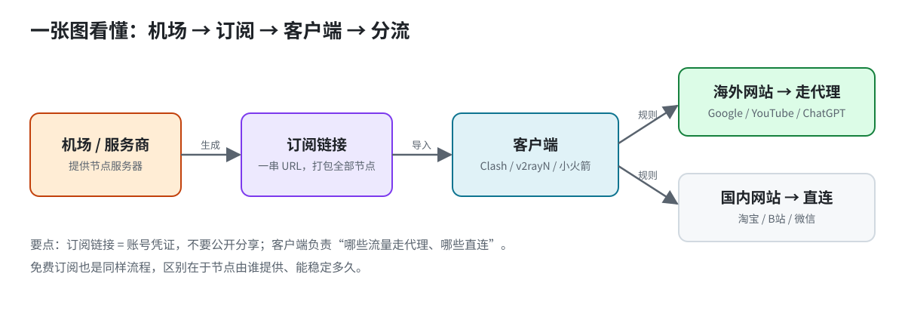
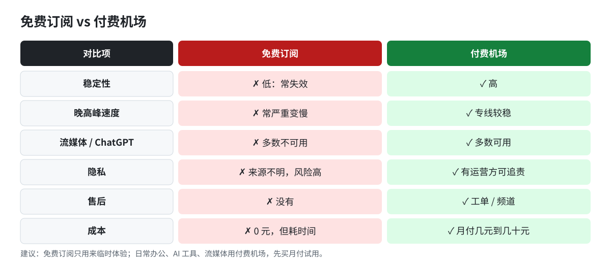
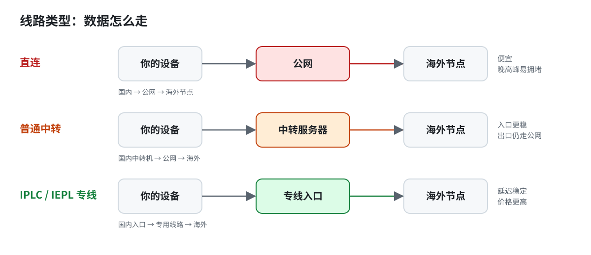
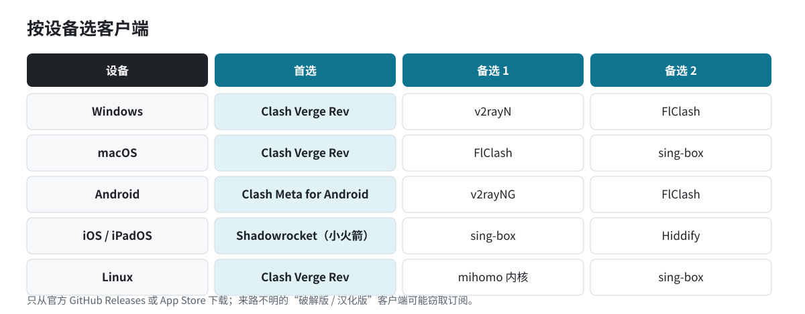
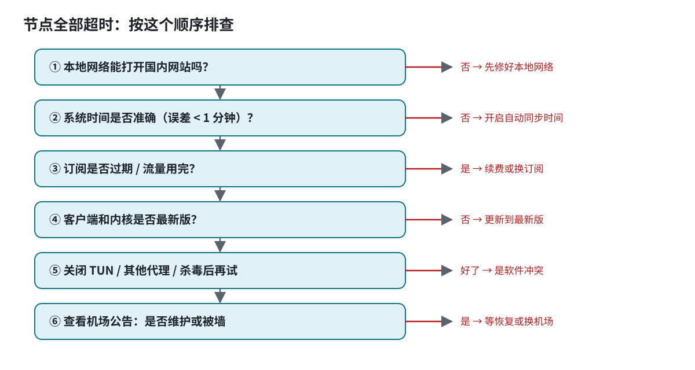

<p align="center"></p>

# Clash 免费订阅与机场推荐 2026｜Clash / v2rayN / 小火箭订阅导入、配置模板与排错大全

> 最后更新：2026 年 11 月 7 日 · 本仓库**不提供、不托管任何节点或订阅链接**，只整理教程、配置模板和排错方法。文中推荐的付费机场含推广链接。

## 30 秒速读

| 你的情况 | 建议 |
|---|---|
| 只想临时看看外网 | 可以先试免费订阅，但做好随时失效的准备，不要登录重要账号 |
| 每天办公、用 ChatGPT / Claude | 用付费机场，优先选专线（IPLC / IEPL），先买月付试用 |
| 看 Netflix / YouTube 4K | 选标注流媒体解锁的机场，晚高峰实测再续费 |
| 完全新手 | 先看「Clash 和订阅是什么」→「按设备选客户端」→ 对应客户端教程 |
| 所有节点都超时 | 直接跳到「节点全部超时怎么办」 |

> **付费备选：红杏云** — 平价专线机场，支持 Clash / Shadowrocket / v2rayN 订阅一键导入，全球 300+ 节点，流媒体解锁，新用户可先买月付试用。
> 👉 [注册红杏云](https://mianfeijiedian.blog/go/airport/)（推广链接）

## 目录

- [30 秒速读](#30-秒速读)
- [Clash 和订阅是什么](#clash-和订阅是什么)
- [免费订阅：从哪来、能用多久、有什么风险](#免费订阅从哪来能用多久有什么风险)
- [免费订阅 vs 付费机场：怎么选](#免费订阅-vs-付费机场怎么选)
- [线路类型：直连、中转、IPLC、IEPL 有什么区别](#线路类型直连中转iplciepl-有什么区别)
- [挑选机场的 10 条核对清单](#挑选机场的-10-条核对清单)
- [按设备选客户端（官方下载地址）](#按设备选客户端官方下载地址)
- [Clash Verge Rev（Windows / macOS / Linux）完整教程](#clash-verge-revwindows--macos--linux完整教程)
- [Android：Clash Meta for Android 与 FlClash 教程](#androidclash-meta-for-android-与-flclash-教程)
- [iOS：Shadowrocket（小火箭）订阅导入教程](#iosshadowrocket小火箭订阅导入教程)
- [v2rayN（Windows）订阅导入教程](#v2raynwindows订阅导入教程)
- [v2rayNG（Android）订阅导入教程](#v2rayngandroid订阅导入教程)
- [sing-box 与 Hiddify：新协议的选择](#sing-box-与-hiddify新协议的选择)
- [Clash / Mihomo 配置模板（可直接改用）](#clash--mihomo-配置模板可直接改用)
- [订阅导入失败 / 更新失败怎么办](#订阅导入失败--更新失败怎么办)
- [节点全部超时怎么办（排查顺序）](#节点全部超时怎么办排查顺序)
- [测速与选节点：延迟高不等于速度慢](#测速与选节点延迟高不等于速度慢)
- [分流规则：规则模式到底在做什么](#分流规则规则模式到底在做什么)
- [DNS、fake-ip 与 DNS 泄露](#dnsfake-ip-与-dns-泄露)
- [术语对照表](#术语对照表)
- [安全与隐私：用代理时要注意的事](#安全与隐私用代理时要注意的事)
- [常见问题 FAQ](#常见问题-faq)
- [延伸阅读](#延伸阅读)
- [免责声明](#免责声明)
- [更新记录](#更新记录)

## Clash 和订阅是什么

想要在网络上获得更稳定、可控的访问体验，很多初学者会听到几个专业名词：Clash、订阅、机场。它们像一条从幕后到前台的“分流工厂”：机场提供原材料（节点），订阅把这些材料打包成可用的表单，客户端导入订阅后按照一组规则来分流流量。用一个简单的比喻来理解：你开了一家菜场，供应商提供不同分店的蔬菜（节点）；你把蔬菜按固定组合打包成菜单（订阅链接）；顾客来买时你把菜单交给前台，前台按菜单和规则把菜送到不同的窗口（代理规则），最终让你吃到想要的菜且不踩到不想吃的辣度。

下面从三者各自是什么、怎么联系，给一个完全新手也能看懂的讲解。全篇以通俗易懂、尽量少专业术语的方式来写，并附上直观的对比和逐步落地的流程。

---

### 1) Clash 是什么，为什么现在主流是 Mihomo 内核

- Clash 是一个跨平台的网络代理客户端框架。它本身像是一座“智能分流工厂”：你把“输入”的网络请求放进来，按照你设定的规则，把请求分给不同的“产线”（代理节点）。

- 它支持多种协议和代理模式，最常见的是 Vmess、V2Ray、Trojan、Socks、HTTP 等等。你可以把它理解成一座能同时理解多种语言（协议）的翻译与分配中心。

- Mihomo 内核（Mihomo）是 Clash 的一个主流实现之一。说白了，就是 Clash 的一个高度优化、稳定、易用的“引擎版本”。不同开发者实现的内核会在性能、启动速度、资源占用、规则语言等方面有些差异。Mihomo 内核在中文社区中特别活跃，文档和示例也更贴近普通用户的使用场景，因此成为现在的主流选项之一。

- 为什么会强调内核？因为你日常真正要做的，是“让流量按照你设定的规则走”，而内核决定了你写的规则能否快速、准确地执行，能否兼容多种节点类型，以及在不同设备上的表现。

要点总结：
- Clash 是一款“多规则、多节点”的代理客户端框架。
- Mihomo 内核是 Clash 的一个常用实现，强调稳定性和易用性，适合新手和常规使用。
- 你真正重要的事情，是会用规则告诉 Clash 如何分发流量。

---

### 2) 订阅链接是什么

- 订阅链接是一种“打包清单”的入口。它把多条节点信息、路由规则、策略组等打包成一个简单的文本地址。你点击或粘贴到客户端后，客户端就能自动把这份清单解析成可用的配置文件。

- 形象地说：订阅就像把你去过的所有菜市场的购物清单整合成一个统一的菜单链接。你只需要一次性拿到这份菜单，后续更新也可以通过同一个链接自动刷新到最新的节点与规则。

- 常见的订阅形式有：
  - 节点清单（多节点信息+元数据）
  - 策略分组与规则集合
  - 订阅会定期更新你所看到的节点与策略，确保你始终拥有可用的分流选项

- 为什么要用订阅？因为直接手动添加上百条节点信息非常繁琐，且节点会时常失效、变动。订阅可以把更新工作集中到服务端，你只需要在本地客户端保持订阅链接就能保持相对“活性”的节点库。

要点总结：
- 订阅链接是一个文本入口，里面包含节点信息与分流规则的集合。
- 使用订阅能让你省去逐条手动添加、更新节点的繁琐，保持节点库的“新鲜”与一致性。
- 客户端会定期拉取订阅内容，然后把其中的节点导入到你的代理配置中。

---

### 3) 机场是什么

- 机场（有时也称为“节点商店/节点提供商”）是你获得可用节点的来源。它们通常提供多条可用的代理节点，可能包含不同地区、不同协议、不同价格等级的节点。

- 机场的工作模式像是一个“菜场供货商”：你在机场买到各种单品（节点），机场还会给你一个适合你需求的套餐或组合（节点的分组、价格、速度等信息）。

- 机场与订阅的关系是：机场提供原材料（节点清单），你订阅的服务把机场提供的节点打包成一个或多个订阅链接，供你的客户端导入并按照规则分流。换句话说，机场是节点的源头，订阅是把这些源头整理好、给你一个便于使用的入口。

要点总结：
- 机场是节点的来源，提供可用的节点信息。
- 订阅将机场提供的节点整理成统一的文本入口，便于在客户端导入和自动更新。
- 三者共同作用，形成一个“节点 → 订阅打包 → 客户端导入 → 按规则分流”的闭环。

---

### 4) 三者关系的直观比喻

- 机场像蔬菜市场的摊位，提供新鲜的蔬菜（各类代理节点）。
- 订阅像一本“菜单+配方”的小册子，把摊位里的蔬菜按固定组合打包成可直接下单的菜单，方便你快速下单且方便后续更新。
- 客户端（Clash、v2rayN、小火箭等）是前台的服务员，你把菜单交给前台，前台按你设定的规则把菜送到不同的窗口，最终端到你桌上。

示例流程（从零开始、最简版）：
1) 你订阅一个订阅链接，里面包含多条节点信息和分流规则。你把这个链接放进 Clash 的订阅输入区域。
2) 客户端定期拉取订阅内容，读取其中的节点清单和策略组信息。
3) 客户端将节点导入配置中，形成一个“全局可用的代理节点集合”。
4) 你在客户端设定好分流规则（比如某些网站走某条节点，娱乐流量走另一条节点，常规访问走直连等），或者直接使用订阅自带的策略组。
5) 当你访问网络时，流量就会按照你设定的规则被分配到不同的代理节点上，达到更稳定、快速且可控的上网体验。

比喻要点回顾：
- 机场：给你新鲜的节点资源。
- 订阅：把资源打包成你可以直接使用、并且能自动更新的“菜单/清单”。
- 客户端：把菜单按你的规则执行，真正把流量分配到各个节点，达成分流上网。

---

### 5) 新手入门的操作要点

- 选择一个适合的机场：关注节点数量、节点分布、稳定性、价格（如果有免费版本也可尝试），以及是否提供你所在地区常用的协议类型。高可用的节点与稳定的连接质量，是得到良好体验的前提。

- 获取订阅链接：多数机场会提供一个订阅链接，复制后放入 Clash 的订阅输入处，或在 v2rayN、小火箭等客户端中找到“订阅地址”输入框。新手优先选择“官方或社区口碑较好”的订阅源。

- 配置 Clash（Mihomo 内核）：
  - 安装并启动 Clash。
  - 找到订阅管理入口，粘贴订阅链接并订阅。
  - 等待客户端拉取并解析订阅内容，确认节点已经导入。
  - 进入“策略/路由”设置，选择一个简单且直观的分流规则（例如：默认走直连，某些域名走代理，特定应用走代理等），或者启用订阅自带的策略组。
  - 保存并应用配置，打开系统代理或应用代理代理设置，开始上网。

- 与其他客户端的对比应用场景：
  - v2rayN：Windows 场景下的直观界面，适合习惯点点点的人群。你需要在 v2rayN 内部导入订阅的节点清单，或者使用 V2RayN 对应的订阅功能。
  - 小火箭（Shadowrocket/Surge 类别在 iOS 上的市场版本名不同，但原理一致）：主要用于移动端，界面简洁，订阅和规则也可以在应用内管理，适合移动端日常使用。
  - Clash：跨平台、强大、灵活，适合希望细致自定义分流规则、想要长远稳定的用户。尤其是在 Mihomo 内核的实现下，兼容性和性能表现普遍较好。

- 遇到问题时的排错思路：
  - 订阅未更新：检查网络是否可访问订阅链接，确认订阅地址是否正确粘贴，没有多余空格。
  - 节点不可用或超时：先确认订阅源中节点的状态，可能需要切换到备用订阅，或者联系机场客服了解节点的稳定性。
  - 分流规则不起作用：确认当前使用的策略组是否正确启用，或者尝试先使用一个简单策略（如全走代理），再逐步添加复杂规则。

- 安全与合规的提醒：
  - 只使用正规、信任的机场和订阅源，避免下载到带有恶意规则的配置。
  - 注意个人隐私与网络安全，不要在公用网络环境下使用含敏感操作的代理访问账号、密码等信息。
  - 遵守当地法律法规，合理使用代理网络。

---

### 6) 快速对照清单

- Clash = 跨平台的代理客户端框架，核心是规则分流和多节点切换。
- Mihomo 内核 = Clash 的一种主流、稳定的实现版本，社区使用广泛。
- 订阅链接 = 将节点信息与规则打包成文本入口，便于自动更新与集中管理。
- 机场 = 提供节点资源的服务商，是可用节点的来源。
- 三者关系 = 机场提供节点 → 订阅打包成可导入的清单 → 客户端导入并按规则分流上网。

---

### 7) 进一步的进阶方向（给愿意深入的朋友）

- 自定义策略组与路由规则：在 Clash 的配置文件中，你可以定义更复杂的流量走向，例如按域名、IP、端口、应用类型等多维条件来分流。这需要你熟悉 YAML 配置格式与 Clash 的路由语法，但一旦掌握，将显著提升上网体验的稳定性和可控性。

- 多订阅源的合并管理：有时一个机场提供的订阅不包含你需要的节点，或者你需要对比不同机场的节点质量。你可以同时添加多个订阅源，在 Clash 中通过策略组实现对不同来源的节点进行独立管理。

- 自动更新策略：通过定时任务或客户端内置的自动更新机制，确保订阅在后台持续刷新，避免因节点失效而影响上网。

- 节点健康监控：一些进阶方案会结合节点的延迟、丢包等指标来动态切换到更好节点。这需要更深入的配置以及对网络知识的理解。

---

如果你愿意，我们可以一起把你的实际设备和目标场景画成一个简化的“配置草图”，包括你偏好的机场、期望的分流规则，以及你要在哪些设备上使用 Clash、v2rayN 或小火箭。你也可以把你遇到的具体问题和日志贴给我，我可以帮你逐步诊断并给出可执行的配置建议。

<p align="center"></p>

## 免费订阅：从哪来、能用多久、有什么风险

免费订阅在代理工具圈里并不少见，尤其是 Clash、v2rayN、小火箭等工具的使用场景。下面按来源、寿命、速度、隐私风险和自我守则等维度，给出一个系统化的认识框架，帮助你在不提供具体链接或节点地址的前提下，理解原理与风险，并学会自我判断是否可疑。

> 提示：本文不提供任何免费订阅的具体链接，只讲原理、风险、判断方法，帮助你更理性地评估信息源的可信度与安全性。

---

### 免费订阅的常见来源

- 公开分享的配置集合
  - 特点：通常由个人或小团队在论坛、博客或社群内公开分享；可能包含多条节点信息、不同的策略组和自定义规则。
  - 优点：获取门槛低、更新灵活。
  - 风险：质量参差不齐、包含劣质节点或被篡改的配置。

- 频道/媒体运营账号
  - 特点：在社交平台、视频号、播客等渠道发布的“免费试用”或“限时订阅”信息；有时附带二维码、分享码等形式。
  - 优点：更新较及时、话题性强。
  - 风险：易被用于传播诈骗、钓鱼订阅或误导性信息；若渠道本身不具备审核机制，内容可信度较低。

- GitHub 仓库或开源项目的相关分支
  - 特点：以仓库的形式托管配置、规则、示例，便于追踪历史和回滚。
  - 优点：版本可控、透明度相对较高。
  - 风险：仓库所有者可能被恶意篡改、分发的配置带有隐蔽风险，且部分仓库标题中可能混入“免费”字眼以吸引点击。

- 机场试用/限时体验
  - 特点：一些公用机场或云端节点提供短期免费试用额度，常见于商业化运营商的“体验计划”和活动。
  - 优点：真正可用、速度相对稳定的机会增加。
  - 风险：体验结束即不可用、续费机制不透明、后续订阅方式需谨慎。

- 其他非正式渠道
  - 如社区互助帖、二手交易群等，信息分散且缺乏权威性。
  - 风险：信息来源不清晰，容易混入钓鱼、欺诈等行为。

---

### 为什么免费订阅寿命普遍较短

- 被滥用和滥发
  - 许多免费订阅来自个人用户或临时性资源，若被广泛滥用，运营方可能迅速调整策略，收紧或直接下架。
  - 机制层面：节点提供商对免费节点的质量和稳定性不可控，资源分配容易被优先分给付费用户。

- 限速/限流
  - 免费来源常以“公平使用”为口号，但实际执行往往落在“单位时间内的带宽和并发数上限”。
  - 当并发量激增时，免费订阅的速度和稳定性会显著下降，导致体验不好，用户流失。

- 安全策略与封禁机制
  - 运营方如检测到异常流量、滥用行为、违反使用政策，可能对相关订阅或账户进行封禁、下架或限流。
  - 封禁机制往往较粗放，新的节点可能随时替换，导致“订阅不可用”的现象时有发生。

- 节点方的变动性
  - 免费节点往往来自第三方个人/小团队，维护能力、资金支持有限，节点稳定性随时间波动较大。
  - 节点运营方可能因政策、成本、技术难题等原因主动下线或迁移节点。

---

### 流量、速度与可用性

- 流量/带宽限制
  - 免费订阅通常设定一个总可用流量或日/周限额，达到上限后可能进入降速、限时断流，甚至不可用状态。
  - 即使初始速度看起来较好，长期使用时也容易因为限流而体验下降。

- 延迟与路由影响
  - 免费节点往往节点分布在全球范围，若离你实际用户位置较远，会带来高延迟和丢包，影响音视频、游戏和实时通信的体验。
  - 路由策略（如分流、分组、智能路由等）对体验影响显著，免费来源往往没有完善的默认策略，需要自行配置。

- 稳定性对比
  - 对比付费商用订阅，免费来源的节点通常更容易波动，需频繁切换配置或替换订阅，这对日常使用带来额外成本。

---

### 隐私与安全风险

- 节点方可看到未加密流量（取决于协议与加密）
  - 如果你使用未加密的转发（或未开启末端加密的服务），节点拥有对你经过的流量的观测能力，尤其是明文请求、账号信息、访问的域名等。
  - 即使使用加密，元数据（如域名、目的地、连接时长等）也可能被节点方看到，形成一定程度的行为画像。

- 注入广告/劫持订阅
  - 某些免费订阅源可能在你设备端修改配置、注入广告规则，或通过劫持订阅过程来引导你访问特定页面、下载恶意插件。
  - 这类行为往往隐藏在“额外配置项”、“广告屏蔽规则”、“钓鱼订阅”等表象之下。

- 钓鱼订阅与伪装
  - 表面看起来很“专业”的订阅，实际来自不可信源，目的是诱导你授权、支付、或下载带有恶意脚本的配置。
  - 常见伪装：看似官方的账号、看起来专业的文档、提供“免费试用期后续续订”的承诺等。

- 数据聚合与跨域风险
  - 部署在不同区域的节点可能把你所在的地理位置、常用域名、时间段习惯等数据汇总，帮助攻击者进行定向攻击或社会工程学利用。

- 设备与软件层面的风险
  - 某些免费订阅提供的配置可能搭载附带插件、脚本，若未经过严格审查，可能带来额外的隐私泄露、广告注入或恶意行为。

---

### 如何判断一个免费订阅是否可疑

以下要点帮助你建立一个“可控、可追溯、可撤销”的判断框架。记住：没有绝对安全的免费订阅，只有尽量降低风险的做法。

- 检查来源可靠性
  - 来源主体：是谁在发布？是否有可验证的身份、长期存在的记录、公开的联系方式？
  - 传播渠道：是否通过受信任的官方渠道、主流社区、知名账号发布？是否有前后文、更新日志、版本号？

- 了解节点提供方与配置的透明度
  - 配置来源是否有版本控制、变更日志、历史记录可查？是否能回溯到原始的节点提供方？
  - 节点的地理分布、提供方的维护周期、更新策略是否清晰说明？

- 审慎对待“免费体验”的承诺
  - 是否要求你在订阅前提供敏感信息、实名认证、支付信息或激活码？若有，请提高警惕。
  - 体验期是否有明示的到期时间、资源量、后续续订条件？是否存在强制跳转到付费流程的行为？

- 检查配置的完整性与安全性
  - 配置文件是否包含可疑的脚本、插件、重定向规则、广告注入点？
  - 是否需要额外的外部依赖、下载器、安装包？这些依赖是否来自可信渠道？

- 评估加密与传输的基本安全性
  - 传输协议是否支持端对端或服务器端加密？是否强制使用明文传输的情形？
  - 是否存在对你实际流量的显式追踪或日志记录的声明？

- 审查权限与日志策略
  - 订阅方是否明确声明会记录访问日志、设备信息、位置信息？是否提供删除或限制日志的选项？
  - 是否有第三方数据共享的说明？数据用途是否合理、符合当地法律法规？

- 兼容性与可控性测试
  - 在不暴露个人账户信息的前提下，尝试小规模的短时测试，关注是否有异常充值、广告劫持、跳转页面等行为。
  - 若可能，使用独立的网络环境（如隔离测试网、临时设备）进行测试，避免在日常工作环境中直接承载关键数据。

- 端对端风控与心智警觉
  - 不要盲目信任“免费=好用”，遇到“无风险、立即生效、无限流量”的说法要保持怀疑。
  - 如遇到要求你绕过正常支付、要求你导入他人账户、或提供私钥/助记词的请求，直接终止并删除相关配置。

- 使用工具与实践
  - 使用可靠的安全工具对下载的配置进行哈希校验，确保未被篡改。
  - 在 Clash/v2rayN/小火箭等客户端中开启最小权限原则：仅使用必需的代理功能，禁用不必要的扩展或插件。
  - 尽量分离个人敏感账号的流量，避免在同一设备上混合使用不可信的免费订阅。

---

### 实践中的“可控使用”建议

- 高度怀疑、低风险的原则
  - 将免费订阅视为临时、补充性质的选项，而非长期主力。优先把付费、可信来源的订阅作为默认方案。
  - 对于任何“需要长期绑定账号、支付信息、或平台级权限”的订阅，务必慎重考虑。

- 越简单越稳妥
  - 尽量选择结构简单、透明度高的配置，避免复杂的重定向和广告注入规则。
  - 关注上线时间、变更频率、以及是否有清晰的维护者信息。

- 记录与备份
  - 对你使用过的免费订阅做简要记录：来源、版本、有效期限、测试结果等，以便追溯和替换。
  - 备份你现有的工作配置，避免因为免费订阅失效导致工作中断。

- 跟进与迭代
  - 如果你信任的来源提供了“透明运维”的承诺（如定期发布更新、可追溯的版本历史、明确的隐私策略），可以适度关注其后续动态。
  - 但一旦源头出现异常变动、明显的广告化、或隐私条款变更，应立即撤出并清理相关配置。

---

### 汇总要点

- 免费订阅来源分散，质量参差不齐，寿命通常受限于资源滥用、限流、封禁与维护成本。
- 免费节点的速度与稳定性常常不如付费方案，且随时间波动较大。
- 隐私风险是核心关注点：未加密流量的暴露、广告注入、钓鱼订阅、数据收集等均可能发生。
- 判断一个免费订阅是否可疑，应从来源可信度、配置透明度、加密程度、日志/数据处理、以及是否有强制性支付或绑定信息等方面综合评估。
- 目标是以最小化风险的方式获得可用性：优先可信、受控、可追溯的来源，谨慎对待任何“免费且无风险”的承诺。

如果你愿意，可以告诉我你当前在使用的客户端（Clash、v2rayN、还是小火箭的版本，以及你所在的地区网络特征），我可以给出更聚焦的自检清单和使用原则，帮助你在不引入额外风险的前提下，提升日常连接的稳定性与安全性。

## 免费订阅 vs 付费机场：怎么选

在大陆用户的日常上网场景里，选择免费订阅还是付费机场，往往直接影响到稳定性、速度、可用性和体验感。本节从以下几个维度进行系统对比，并给出在不同场景下的实用建议，方便你在 Clash、Shadowrocket、v2rayN、小火箭等工具中落地使用。

> 提示：本文所提及的付费机场均以“可见的公开信息”为基础做概览性描述，并给出选用时的重点关注点。具体的价格、优惠活动、节点数量等信息请以官方公告为准，本文不提供价格和测试数据链接，不含具体订阅地址或节点地址。

---

### 1) 从稳定性、速度、晚高峰等维度的全景对比

- **稳定性（Connection Consistency）**
  - 免费订阅：通常因免费用户多、资源共享、节点轮转频繁，稳定性会随时间波动。可能出现短时中断、节点拥堵、切换频繁的情况。部分免费订阅会对高峰期限流，稳定性相对较低。
  - 付费机场：通常通过更高带宽、专线或更合理的节点分布来维护稳定性，故障恢复、自动切换、分流策略相对更完善。对于需要持续在线的工作与学习场景，稳定性是核心指标之一。
- **速度（Throughput 与 Latency）**
  - 免费订阅：速率通常较低，峰值性能可能在试用期内看起来还不错，但经常被带宽限速、测速波动、跨区域节点不平衡所影响。国际带宽、绕行策略不合理时延可能较高。
  - 付费机场：通过多节点、全局覆盖、专线回路等实现更稳定的高吞吐。跨区域访问、视频会议、远程开发环境等对延迟敏感的场景常有更好的体验。
- **晚高峰表现（Peak Hour Performance）**
  - 免费订阅：高峰时段容易出现卡顿、丢包或者连接失败，因用户量攀升导致资源紧张。夜间或周末时段可能略有好转，但波动仍然明显。
  - 付费机场：通常会有更干净的高峰时段表现，部分机场提供专门的拥塞控制或智能路由策略以平滑高峰压力。
- **流媒体解锁（Streaming Unblocks）**
  - 免费订阅：部分对常用流媒体平台的解锁能力有限，且解锁成功率和稳定性随节点变动而波动。遇到地域限制更新时，解锁能力可能迅速失效。
  - 付费机场：若提供多区域节点和专门策略，解锁体验往往更稳定（但不保证所有地区都解锁），并且对明确的流媒体平台有持续测试与维护。
- **ChatGPT 与综合出海可用性（GPT 相关、可访问性）**
  - 免费订阅：某些地区的访问可能受限，或者需要不断变更服务器域名、代理端口来绕过封锁。稳定性较差，且变动成本高。
  - 付费机场：在稳定性和持续可用性方面通常更具可控性，便于长期工作和开发使用，减少环境切换成本。
- **隐私与安全（Privacy & Security）**
  - 免费订阅：较难确认运营方的隐私保护策略，广告、数据收集、账号共享等风险存在不确定性。部分免费方案可能对用户数据有更高的可用性要求。
  - 付费机场：通常有更明确的隐私政策和更严格的合规流程，但也需要对日志策略、订阅方式、支付方式的透明度保持警惕。优选具备独立企业主体、清晰日志保留策略的服务。
- **售后与服务体验（Support & Reliability）**
  - 免费订阅：自助式、社区驱动的支持常见，响应速度与专业性不稳定，遇到问题时解决难度高。
  - 付费机场：一般提供更直接的客服和售后保障，遇到故障、节点变动有更明确的申诉/退款流程。对企业级需求尤为重要。
- **跑路风险（Risk of Shutdown）**
  - 免费订阅：存在较高的“跑路”或长期不可用风险，用户需要频繁切换方案，数据安全性、账号完整性难以保障。
  - 付费机场：相对稳定性更高，但仍需评估运营方的合规性、资金流水、企业主体风险等。正规支付、稳定的业务模式通常降低跑路概率。
- **每月成本（Monthly Cost）**
  - 免费订阅：零成本，短期看似省钱，但长期的可靠性成本、时间成本、切换成本往往更高。
  - 付费机场：需要月度或季度订阅费，但通常换来更高的可用性、稳定性和工作效率。决策点在于你对“稳定性/可用性”的价值评估。

---

### 2) 用免费订阅的场景（适合短期、低需求、尝鲜为主）

- 试水阶段：想快速体验代理、路由工具对比，了解自己设备端子的基本操作方式与工作流。
- 临时需求：短时间内需要访问特定区域资源、且对稳定性要求不高的任务，比如一次性资料下载、短时娱乐浏览等。
- 学习与实验：学习 Clash、v2rayN、Shadowrocket 的基本用法、配置文件结构、订阅地址导入流程等。
- 风险低容错场景：对隐私保护、日志留存等要求不高，愿意承担遇到问题时自行排错的态度。

注意要点
- 你需要对节点轮换、订阅更换、端口变动等行为保持容错能力。
- 尽量在测试环境中分流，不把正式工作流全靠免费订阅承载。
- 避免将个人敏感信息、账号密码、工作资料等长期通过免费代理传输。

---

### 3) 需要付费机场的场景（必须优先考虑付费方案时的判断）

- 长期工作与学习依赖：经常性需要稳定访问、跨区域协作、远程开发、视频会议、数据传输等，高稳定性和低延迟成为生产力工具的一部分。
- 流媒体解锁需求明确且持续：若要经常观看海外流媒体、或访问区域受限的内容，较高的成功解锁率和可靠性更省心。
- ChatGPT / AI 服务高并发访问：需要持续稳定地接入 API、网页端服务的场景，免费方案的波动会直接干扰工作。
- 隐私与安全性高要求：有企业账户、工作资料、个人隐私敏感信息传输需求，更希望有明确的日志策略与数据保护承诺。
- 避免跑路风险、需要售后保障：希望遇到问题时能有明确的客服、退款与申诉机制，降低单点故障的风险。
- 预算与成本可控：虽然是付费，但若性价比高、稳定性好、可预期成本可控，长期使用的总成本也会更低于频繁切换带来的时间成本。

推荐关注点（付费机场的一般要素）
- 节点覆盖广度与质量：全球节点是否稳定，是否有你常访问区域的优先分配。
- 路由策略与负载均衡：是否有智能分流、带宽分配、失败自动重连等机制。
- 兼容性与易用性：对 Clash、Shadowrocket、v2rayN、小火箭等主流工具是否有一键导入、友好订阅格式。
- 隐私承诺与日志策略：明确的无日志或最小必要日志，并披露数据处理流程。
- 支付与售后：支持的支付方式、购买凭证、退款政策、客服渠道与响应时长。

备选付费机场（仅作为备选提及，信息以官方公告为准）
- 红杏云等可选支付方所提供的机场
- 平价专线机场（Economy Line Airport）等可选方案
- 以上方案支持 Clash / Shadowrocket / v2rayN 订阅一键导入，全球 300+ 节点，流媒体解锁，新用户可先买月付套餐试用

温馨提示
- 以上仅作为备选信息的描述，不构成任何推荐或价格承诺。具体的价格、服务条款、节点质量需以官方披露为准。
- 在选择付费机场时，优先考虑稳定性、隐私保护、售后响应速度，以及你常用的设备与地区的兼容性。

---

### 4) 从“怎么选”到“怎么落地”的实用框架

下面给出一个简化的决策框架，帮助你在日常使用中快速落地选择。

- 你现在的核心需求是什么？
  - 如果需要长期稳定工作、跨区访问及高质量流媒体解锁，优先考虑付费机场。
  - 如果只是短期测试、偶发需求、对稳定性容忍度较低，免费订阅可以作为第一步尝试。
- 你的地区和访问目标是哪些？
  - 若你需要访问对延迟敏感的服务（云开发、远程桌面、视频会议），付费机场通常更合适。
  - 若你主要进行浏览、资料下载等对速度要求不高的活动，免费方案的成本效益可能更高。
- 你对隐私和安全的重视程度如何？
  - 高度关注隐私的用户，应优先使用透明日志策略和可核验的隐私保护承诺的付费机场。
  - 若对隐私要求相对宽松，且愿意接受一定风险，免费订阅依然是一个可选路径，同时注意避免传输敏感数据。
- 预算与成本的权衡
  - 若预算有限且能接受波动，免费方案可能是起点。
  - 若预算允许，且对稳定性、售后、解锁能力有明确需求，付费机场的性价比通常更高。

---

### 5) 如何在 Clash / Shadowrocket / v2rayN / 小火箭中落地

- 订阅地址导入
  - 免费与付费机场通常提供便捷的订阅链接或二维码，直接在客户端导入即可。注意不同客户端对订阅格式的兼容性差异，必要时进行格式转换。
- 路由策略的选择
  - 对于需要保持稳定访问的场景，优先选择全局代理或直连优先策略，尽量避免过度分流带来的额外开销。
  - 如果你在国内外网站之间切换较多，可以开启分应用代理（按应用走代理）来提升体验。
- 节点优先级与健康检测
  - 部分客户端支持节点健康检测、自动轮转节点。开启后，遇到连接失败时会自动尝试其他节点，提升可用性。
- 日志与隐私配置
  - 尽量在客户端开启最小日志或禁用调试日志。留意本地设备的备份策略，确保订阅信息和配置文件安全。
- 安全性与更新
  - 使用最新版客户端、定期清理过期节点、关注机场公告的安全性更新，避免长期使用明显不再维护的节点。

---

### 6) 常见坑与实用规避方法

- 坑：免费订阅节点大量更换，导致频繁断线、路由失效
  - 应对：建立稳定的本地代理策略，避免把关键工作流全压在单一免费节点上；定期备份配置文件，快速切回工作场景。
- 坑：流媒体解锁忽然失效
  - 应对：多备份节点、关注官方公告，必要时切换到具备解锁能力的替代节点；避免频繁尝试过多不同国家/地区的节点以免触发反侦察机制。
- 坑：隐私与日志不透明
  - 应对：优先选择有清晰隐私政策的付费机场，注意本地设备的日志设置，避免将敏感信息通过代理传输。
- 坑：价格波动和订阅到期
  - 应对：设定预算上限，关注淡旺季优惠，同步预存年费/月费方案，避免因价格调整导致使用中断。

---

### 7) 场景化对比速览（简要摘录）

- 场景 A：日常浏览、偶尔访问海外站点、对稳定性要求不高
  - 首选：免费订阅，作为试用入口。必要时逐步迁移到付费机场。
- 场景 B：远程办公、视频会议、跨区数据传输、对稳定性要求高
  - 首选：付费机场，且优先评估其对你常用地区的节点覆盖与带宽。
- 场景 C：全域流媒体、解锁需求明确且持续
  - 首选：付费机场，结合多区域节点与稳定解锁能力，定期关注解锁策略更新。
- 场景 D：注重隐私保护、对日志透明度要求高
  - 首选：付费机场中的有明确隐私政策的方案，搭配本地安全策略与设备端的隐私保护设置。

---

### 8) 简易的“自我检测清单”（落地 checklist）

- 你需要代理服务的场景频率（每日/每周/偶尔）？
- 你访问的目标区域主要在哪些国家/地区？
- 是否对流媒体解锁有明确需求且需要长期稳定？
- 是否对日志与隐私有明确的要求？
- 预算区间是多少？是否愿意为稳定性和售后付费？

若以上答案偏向“高稳定性、长期使用、隐私保护、可预期成本”，请优先考虑付费机场；若偏向“低成本、尝鲜、短期测试”，可从免费订阅开始，并在必要时逐步过渡到付费方案。

---

### 9) 给读者的实际建议

- 把需求分成“工作/学习”与“娱乐/日常使用”两大类，并以此为基准决定是否走付费路线。
- 不要把关键工作完全放在免费方案上，建立双轨策略：日常工作走付费机场，娱乐和临时需求可用免费方案作为备用。
- 对于刚入门的用户，优先学习客户端的基本配置、订阅导入与简单路由策略，逐步提升对网络环境的掌控能力。
- 选择付费机场时，重点关注节点覆盖广度、解锁能力、售后响应、日志策略和隐私保护承诺，并结合你常用设备的兼容性进行评估。

---

如果你愿意，我可以根据你的实际使用设备（如桌面客户端、手机端、路由器固件）和你常访问的区域，给出一个更具体的落地配置模板（包括 Clash 配置示例、v2rayN 的导入步骤、以及 Shadowrocket 的路由策略建议），帮助你快速搭建一个稳定、可维持的网络代理环境。

<p align="center"></p>

> **付费备选：红杏云** — 平价专线机场，支持 Clash / Shadowrocket / v2rayN 订阅一键导入，全球 300+ 节点，流媒体解锁，新用户可先买月付试用。
> 👉 [注册红杏云](https://mianfeijiedian.blog/go/airport/)（推广链接）

## 线路类型：直连、中转、IPLC、IEPL 有什么区别

以下内容面向大陆地区普通用户，目标是帮助你在使用 Clash、v2rayN、小火箭等工具时，理解机场（VPN/代理服务商）在宣传页上常用的“线路类型”及其实际含义、优缺点，以及如何在订阅页和宣传页上更冷静地筛选。没有任何订阅地址、节点地址或具体服务商信息。

---

##### 一、基础概念：线种到底在“连谁”和“怎么连”

- 直连（Direct / Direct Connect）
  - 含义：你的请求直接经过你所在网络出口，穿过电信网/互联网，直达目标服务器或目标节点。
  - 特点：延迟通常最低、稳定性易受家里网络、运营商、目的地网络波动影响；价格通常最便宜（或同价位里最简单的架构）。
  - 使用场景：对延迟敏感、希望最简单、没有中间跳点的场景。

- 普通中转（Transit / Standard Transit）
  - 含义：你的流量经过一个或若干中转节点（中继服务器/代理网络），再到达目标。你可以理解为“走中间商”。
  - 特点：增加了额外跳点，可能带来稳定性提升（如中转节点质量较好、对抗拥塞能力强），但也会带来额外延时。
  - 使用场景：需要稳定性、对某些地区的路由优化、或对比直连更易穿透某些网络限制时。

- 隧道中转（Tunnel Transit / Tunneling Transit）
  - 含义：在中转的基础上，流量通过一个隧道封装（如加密隧道、V2Ray/VMess、Shadowsocks 等协议隧道）进行传输。
  - 特点：提供了数据加密、混淆和VLAN级别的路由控制，能提高跨区域穿透能力，可能带来额外的加密开销和处理延迟。
  - 使用场景：需要混淆、穿透严格网络策略，或者提升跨国/跨地区的可用性。

- IPLC（International Private Leased Line，国际专线）
  - 含义：跨国企业级专线，直接在服务商之间以专线形式互联，通常由运营商提供的点对点链路。
  - 特点：带宽、时延、抖动通常非常可控，稳定性和安全性较高，价格显著高于普通公网流量。
  - 使用场景：追求“企业级稳定性与确定性”的场景，如稳定的国际业务接入、对时延/抖动极端敏感的应用。

- IEPL（International Ethernet Private Line，国际以太网专线）
  - 含义：与 IPLC 类似，但基于以太网的专线，通常在同一运营商网络内进行高带宽、低时延的互连。
  - 特点：与 IPLC 相近，偏向以太网协议承载，常见于大流量、对带宽对齐要求较高的场景。
  - 使用场景：需要大规模稳定出海、对带宽和对时延有严格控制的应用。

- BGP 入口（BGP Ingress / BGP for Internet Exchange）
  - 含义：通过 BGP（边界网关协议）从特定自治系统（AS）入口进入运营商网络，选择最佳路由。
  - 特点：路由选择由运营商的路由表决定，可能带来更实用的跨域路由优化，但也带来不可控的路由波动与时延变化。
  - 使用场景：需要“看起来更自然”的跨大区路由、抗抖动需求、及对特定对端路由有优化诉求时。

- 家宽 IP / 原生 IP
  - 家宽 IP：你家里宽带分配的公有 IP，通常是动态或半静态，对外出站地址可见。
  - 原生 IP：直接由运营商分配的公网 IP，通常在没有 NAT 的情况下对外暴露，稳定性和可控性可能比家庭宽带更好。
  - 含义：你在没有经过其他代理的情况下，对外暴露的 IP 地址类型。很多机场会在宣传中强调“原生 IP、稳定出口”等卖点。

- 速度、稳定性、价格、晚高峰的影响
  - 直连：速度通常最快，延迟最低，稳定性强度受本地网络和目标端点影响，价格最友好，晚高峰对直连的影响取决于你家宽的拥塞情况和对端带宽需求。
  - 中转：速度和延迟介于直连和高等级专线之间，稳定性有时比直连好（因为中转节点有统一的治理）；价格通常比直连高，但比专线低。
  - 隧道中转：在中转基础上增加了加密隧道，可能牺牲少量吞吐与延迟，但提升隐私和穿透能力，价格通常介于一般中转和专线之间。
  - IPLC/IEPL：速度极高且时延可控，抖动低，适合稳定性要求极高的场景；价格明显偏高，通常以月费或按带宽计费。
  - BGP 入口：路由调度影响显著，可能带来“某些时段好某些时段坏”的波动，适合对路由细节有需求的进阶用户；价格视具体服务商与带宽而定。
  - 家宽 IP / 原生 IP：家宽 IP 的对外暴露会有 NAT/端口限制、UPnP 限制；原生 IP 更方便做对外服务绑定、端口映射，稳定性可能略高，但也依赖运营商策略。

- 新手如何看懂机场宣传页上的这些词
  - 先分清目标：你关心的是“速度/稳定性/价格/穿透能力”还是“可控性/可预测性”？
  - 看对比表：许多宣传页会给出“直连 vs 中转 vs IPLC/IEPL”的对比，关注延迟、抖动、丢包、带宽、价格区间、是否含有隧道加密、是否提供原生 IP。
  - 留意“晚高峰场景”描述：真实环境中晚高峰时段流量飙升，若宣传页强调“晚高峰吞吐无损/稳定”，就需要结合实际带宽需求和你所在地区的网络状况做判断。
  - 留意 IP 类型：如果你需要对外服务器的端口穿透、搭建外部服务，原生 IP/IEPL/IPLC 的稳定性和对 NAT 的友好性会更重要。
  - 注意价格结构：一些低价宣传可能以“流量上限、带宽上限、节点数量”来作卖点，实际体验时要留意是否有隐藏的峰值、带宽上限、月/年费等。
  - 看路由与出口：BGP 入口通常强调对路由的优化能力、对跨区域的穿透和稳定性；如果你对公网对端非常挑剔，可能会考虑这种入口。
  - 结合实际需求：若你使用 Clash/v2rayN/小火箭，关注的往往是“是否支持该工具的代理协议、是否有对 mux、多路复用、加密协议的友好支持，以及节点的地理分布是否覆盖你常用的目标地区”。

---

##### 二、对比要点（简表式理解）

- 直接对比维度
  - 入口类型：直连 / 普通中转 / 隧道中转 / IPLC / IEPL / BGP 入口
  - 典型时延变化：直连最低；普通中转略高；隧道中转更高一些；专线通常低抖动且可控
  - 抖动/丢包：直连若网络稳定则好；中转和隧道可通过选择高质量中转节点提升稳定性；专线抑制抖动能力强
  - 吞吐与带宽：直连和中转在普通带宽下表现良好；专线可配置更高带宽
  - 成本：直连最低；普通中转中等；隧道中转偏中等；专线最贵
  - 适用场景：直连日常使用；中转做稳定性/穿透折中；隧道中转注重隐私与穿透；专线/IEPL/IPLC 面向企业级稳定性与大带宽需求

- 具体的指标关注点（新人版）
  - 延迟（Ping/RTT）与抖动（Jitter）：越低越好，尤其是对游戏/实时应用
  - 丢包率：0%~1% 通常还能接受，>1% 会明显影响体验
  - 带宽稳定性：峰值与持续带宽是否一致，晚高峰时仍能达到承诺带宽
  - 路由稳定性：不同时间段路由变化是否明显，是否需要手动选择出口
  - 隧道开销：隧道加密会带来额外开销，注意实际吞吐是否被放大或缩小
  - IP 类型需求：是否需要对外服务绑定固定公网 IP，是否有 NAT 限制

---

##### 三、实战建议：新手如何在工具中落地

- 确定目标
  - 如果你只是想上网、看视频、办公，优先考虑直连或高性价比的中转，关注低延迟和较好稳定性即可。
  - 如果你需要对外搭建服务、端口映射、对对端有严格穿透需求，优先考虑原生 IP/IEPL/IPLC 类型，且要评估成本是否接受。

- 选型中的检查清单
  - 是否有明确的出口地点覆盖你常用的目标区域（如你常访问的国家/地区节点是否成熟）？
 你所在地区的晚高峰通常会对哪种类型带来更明显的波动？
  - 是否支持你日常工具的协议与混淆需求（如 Clash 的混淆、V2Ray 的多路复用等）？
  - 是否提供隧道加密、混淆、端口映射等实用特性？
  - 是否有按带宽/按月计费的清晰价格表，避免隐藏费用？
  - 是否提供可观测的测速/测试工具，方便你在订阅前做对比？
  - 是否有对外暴露的 IP 类型（原生 IP、固定 IP、动态 IP）的说明？

- 实操小技巧
  - 先用试玩/短期套餐做对比：在正式长期订阅前，先用一个月或两周的时间对比直连、普通中转、隧道中转的实际体验。
  - 以你常用的应用场景对比：比如 Clash/v2rayN 的代理速度、Go 版客户端的稳定性、以及小火箭在苹果/安卓端的表现。
  - 避免盲目信任“广告语”：很多宣传页把词语包装得很美，但实际体验因地区、运营商、节点质量而异。以实际测速和稳定性为准。
  - 记录对比数据：对比不同入口类型在同一时间段（如晚高峰）下的 RTT、带宽、丢包等，形成自己的判断标准。

---

##### 四、术语对照表

- 直连（Direct）: 直接走公网上的出口，最省时延、成本最低。
- 普通中转（Transit）: 通过中转节点转发流量，稳定性可提升但带来额外跳点。
- 隧道中转（Tunnel Transit）: 中转之上再封装隧道，提升隐私和穿透性，可能增加延迟。
- IP 与原生 IP:
  - 家宽 IP: 家庭宽带分配的公网地址，常伴 NAT/端口限制。
  - 原生 IP: 直接暴露的公网地址，便于对外服务绑定和稳定性。
- IPLC/IEPL: 国际专线，高稳定性、高带宽、成本最高，多用于企业级接入。
- BGP 入口: 通过 BGP 路由入口接入运营商网络，路由优化潜力大但波动较依赖运营商策略。

---

##### 五、总结（可用于 README 的落地要点）

- 派生出多种线路类型的根本目标，是在不同成本与风险预算之间取得平衡：直连提供最低时延成本；中转在稳定性和穿透之间找到折中；隧道中转提升隐私和绕过限制；IPLC/IEPL 提供企业级的稳定性与带宽；BGP 入口通过路由优化寻求更好的跨域体验。
- 对于大陆普通用户，理解“价格-性能-稳定性”的三角关系比试图追求“最强”的单点更重要。选型时先明确用途，再结合晚高峰表现、出口地区覆盖、以及是否需要对外暴露固定 IP。
- 最重要的是用实际数据说话。通过对比测试（不同入口类型在同一时间段的延迟、抖动、带宽、丢包），建立自己的评估标准，避免被宣传语误导。

如果你愿意，我可以基于你目前的使用场景，帮你拟一个简单的对比表格模板，方便你在不同机场宣传页之间做快速对比和记录。

<p align="center"></p>

## 挑选机场的 10 条核对清单

在买机场之前，逐条核对以下要点，能显著降低踩坑的概率，尤其是中国大陆普通用户希望通过 Clash / v2rayN / 小火箭等工具使用。每一条都给出“为什么重要”和“怎么验证”的思路，避免只看表面参数就下单。

- 1) 运营时间（可用时长、稳定性与节假日影响）
  - 为什么重要
    - 运营时间决定了你实际能用的时长和稳定性，遇到节假日或当地网络繁忙时段，服务器稳定性可能波动，影响连线体验。长期稳定的运营时间是服务方对用户承诺的体现。
  - 怎么验证
    - 查看商家在公示页面的服务时长、维护公告和历史变更记录，关注最近一个月的异常通知次数。
    - 同类产品的口碑对比，尤其是用户在社群的长期反馈（非首次体验的持续评价）。
    - 尝试购买后在前 1–2 天内记录连接成功率、平均延迟和掉线情况，若经常性断线或无响应，应提高警惕。
  - 提示
    - 如果对比多个机场，优先选运营时间透明、维护安排清晰、历史公告可追溯的服务。

- 2) 试用或月付策略
  - 为什么重要
    - 你在自己网络环境中的使用体验，往往比宣传页的参数更关键。试用/月付能让你在短期内验证速度、稳定性、对不同应用的兼容性。
  - 怎么验证
    - 了解是否支持“月付首月低价/无绑定、30 天无条件退款”等常见试用条款。
    - 记录下载/上传速度、连接成功率、对你常用应用的兼容性（Clash、v2rayN、小火箭等），以及是否需要额外的配置步骤。
    - 关注到期自动续费、续费价格是否明确、是否有隐藏费等。
  - 提示
    - 如果你不确定，优先选择提供明确试用期的方案，并对比同类产品的性价比。

- 3) 退款政策
  - 为什么重要
    - 一旦遇到不符合预期、或产品与宣传不符，退款政策决定你能否无痛回退。清晰的退款条款也反映出商家的服务诚信。
  - 怎么验证
    - 查看退款门槛（如使用时长、已用流量、是否有已下载的配置文件等限制）。
    - 了解退款时效（到账时间）、退款渠道、及是否需要联系人工客服。
    - 核对是否存在“不可退款”的特殊情形，以及是否提供部分退款的安排。
  - 提示
    - 优先选择标注“无条件退款期”或“30 天内可全额退款”的选项作为备选。

- 4) 节点地区与覆盖
  - 为什么重要
    - 节点地理分布直接影响你对某些地区资源的访问速度、稳定性以及对地理审查的通过效果。对于流媒体解锁、低时延游戏等用途，节点分布尤为关键。
  - 怎么验证
    - 查看公开的节点清单及分布地图，关注你常用地区是否有节点覆盖，是否有节点在你所在的洲/国家。
    - 通过多次连接测试，记录不同节点的延迟（Ping、TLS 握手时延等）与丢包率。
    - 注意节点质量的波动，了解商家是否提供按地区分级的评估报告或稳定性说明。
  - 提示
    - 如果你对地域敏感，优先挑选覆盖广、分布均匀且节点稳定性有公开评价的机场。

- 5) 流量和重置周期
  - 为什么重要
    - 流量限额和重置周期直接决定了你在一个周期内能用多少流量，以及重新计费/重置时机，这关系到成本控制和实际可用性。
  - 怎么验证
    - 询问并确认“月度流量上限、每日/每月重置时间点、是否有无上限情况下的限速或带宽限制”等信息。
    - 查看商家提供的流量明细页面，确认是否有透明的时长与流量统计口径。
    - 记录实际使用中的流量消耗节奏，看看是否与承诺相符，是否存在隐藏的“峰值时段流量 throttling”。
  - 提示
    - 对于需要长期使用的用户，选择提供清晰流量和重置规则的方案，避免月中突现额外费用。

- 6) 设备数限制
  - 为什么重要
    - 设备数限制决定你能同时在哪些设备上使用机场（如电脑、手机、路由器等）。如果你打算多设备同时在线，必须确保授权范围符合需求。
  - 怎么验证
    - 查看购买页面对“同时使用设备数”、“家庭/家庭网段绑定”等的描述。
    - 询问是否允许“轮换使用”或是否有“家庭共享”的政策，以及是否需要额外购买许可。
    - 在实际使用中测试多设备同时连接的稳定性，观察是否会出现频繁断线、强制下线等情况。
  - 提示
    - 若你计划多设备使用，优先选择公开声明支持多设备使用、且提供合理的扩容选项的方案。

- 7) 协议支持与加密/混淆参数
  - 为什么重要
    - 你偏好的工具（Clash、v2rayN、小火箭）对代理协议支持程度影响你能否顺利导入并使用，且不同协议对穿透、防封与隐私的影响不同。
  - 怎么验证
    - 了解机场支持的协议种类（如 VMess/VLESS/XTLS、Shadowsocks、Trojan、WireGuard 等），以及是否有对混淆、伪装、TLS 等的支持。
    - 询问是否提供完整的配置模板或订阅导出格式，确保你能在客户端中一键导入。
    - 如果你主要使用 Clash/v2rayN，请确认是否能稳定导入订阅、以及对订阅更新的处理方式（自动更新、手动更新、格式变更的兼容性）。
  - 提示
    - 协议和加密的选择应结合你所在地区的网络环境与客户端版本，避免因为不兼容导致连不上或被识别。

- 8) 客户端支持与配置便利性
  - 为什么重要
    - 客户端支持的广度和易用性，直接影响你日常配置、排错和版本更新的效率。对普通用户来说，简单直观的导入/更新流程是关键。
  - 怎么验证
    - 确认订阅导入是否“一键导入/自动导入”，以及是否提供官方/自建的客户端配置模板。
    - 了解对主流客户端的原生支持情况（Clash、v2rayN、Shadowsocks、小火箭等），包括是否有专门的订阅链接、配置私钥/证书的处理方式。
    - 观察是否提供常见故障排查指南、FAQ、以及快速定位问题的帮助文档。
  - 提示
    - 如果你经常切换设备或系统版本，优先选择提供跨平台、易于维护的方案，减少手动配置工作。

- 9) 售后渠道与技术支持水平
  - 为什么重要
    - 遇到连接问题、订阅更新、计费纠纷等时，及时、专业的售后能让你更快恢复使用。良好的售后是长期使用的安心保障。
  - 怎么验证
    - 了解有无多渠道客服（邮箱、工单系统、即时通讯工具、社区群组等），以及响应时长的公开承诺。
    - 关注历史问题处理速度、用户对售后体验的口碑与案例，尤其是跨时区的问题处理效率。
    - 尝试在购买前以“常见问题”向客服咨询，观察回复的专业程度、可操作性以及是否给出明确的解决路径。
  - 提示
    - 优先考虑有清晰的售后流程、成熟的帮助社区、以及对用户反馈有持续改进的服务。

- 10) 跑路信号与安全信号
  - 为什么重要
    - “跑路信号”涉及商家是否有风险、是否可能突然停止服务、是否存在资金链断裂等风险。提前识别能防止你在关键时刻遭遇断网。
  - 怎么验证
    - 看历史公告的频率与内容：是否有大量突然的服务中断、价格大幅调整、政策变动等记录。
    - 关注资金端的可追溯性，例如支付渠道的稳定性、是否容易追回、以及是否有长期合规的经营信息。
    - 观察社区与用户群体的长期口碑，避免只看短期促销时的热度。
  - 提示
    - 尽量选择口碑稳定、合规透明、财务与服务信息可公开追溯的服务商，降低“跑路风险”的概率。

> 实操小贴士
- 备选方案与对比：在你初步锁定一个机场前，先找 2–3 个替代方案做对比，重点放在以上 10 条的关键差异点。对比表格化记录，方便后续回顾和决策。
- 付费机场的参考：市场上有如红杏云、平价专线机场等可作为备选，特点包括支持 Clash / Shadowrocket / v2rayN 订阅一键导入、全球 300+ 节点、流媒体解锁等。新用户可考虑先买月付套餐进行试用，评估在你常用应用中的表现，以及对你所在地区的可用性。注意：具体价格和测试数据请以官方公布信息为准，本文不提供价格与具体节点地址。
- 合理分阶段购买：先用月付或试用期验证稳定性、再考虑更长期的订阅，以减少一次性投入带来的风险。
- 客户端版本与系统兼容性：确保你使用的 Clash / v2rayN / 小火箭版本能够良好支持所选机场的协议与订阅格式；必要时在官方社区查找针对特定版本的注意事项。

总结与落地建议
- 按以上 10 条逐条核对后，整理成一个自己的“核对清单表格”，在购买前给予每条一个打分（如 1–5 分），总分高者优先。这样能把“看起来不错”的印象，转化为“实际可用”的体验。
- 对于中国大陆用户，兼顾网络环境的多变性，优先选取对常用客户端有明确支持、导入流程简单、且售后和退款政策清晰的方案。
- 记住：没有一个机场是“完美无缺”的。关键是找到在你实际使用情境下，综合性价比最高、且具备可持续服务能力的选项。

附注：若你在寻找可作为备选的市场参考，请关注的特性包括：对 Clash / Shadowrocket / v2rayN 的订阅一键导入、广泛的全球节点覆盖、对流媒体解锁有无明确承诺，以及新用户的试用/月付政策是否友好等。实际购买前，请以官方发布的信息为准，并在可控的时间窗口内完成测试与对比。

## 按设备选客户端（官方下载地址）

<p align="center"></p>

| 客户端 | 平台 | 官方地址 | 说明 |
|---|---|---|---|
| Clash Verge Rev | Windows / macOS / Linux | [GitHub Releases](https://github.com/clash-verge-rev/clash-verge-rev/releases) | 目前最常用的 Clash 图形客户端，Mihomo 内核 |
| FlClash | Windows / macOS / Android / Linux | [GitHub Releases](https://github.com/chen08209/FlClash/releases) | 界面简洁，多平台同一套操作 |
| Clash Meta for Android | Android | [GitHub Releases](https://github.com/MetaCubeX/ClashMetaForAndroid/releases) | 安卓上的 Mihomo 官方客户端 |
| Mihomo 内核 | 全平台（命令行） | [GitHub](https://github.com/MetaCubeX/mihomo) | 原 Clash Meta，路由器 / 服务器用 |
| v2rayN | Windows / macOS / Linux | [GitHub Releases](https://github.com/2dust/v2rayN/releases) | 支持 Xray / sing-box 内核 |
| v2rayNG | Android | [GitHub Releases](https://github.com/2dust/v2rayNG/releases) | 安卓 V2Ray 客户端 |
| sing-box | 全平台 | [GitHub](https://github.com/SagerNet/sing-box) | 支持 Hysteria2 / TUIC / Reality 等新协议 |
| Hiddify | 全平台 | [GitHub Releases](https://github.com/hiddify/hiddify-app/releases) | 基于 sing-box 的图形客户端 |
| Shadowrocket（小火箭） | iOS / iPadOS | [App Store](https://apps.apple.com/app/id932747118) | 需要非中国区 Apple ID 购买 |

> Clash for Windows、ClashX 等旧客户端已经停止更新，新用户直接用 Clash Verge Rev 或 FlClash。

## Clash Verge Rev（Windows / macOS / Linux）完整教程

- 适用对象：在中国大陆环境下使用 Clash、v2rayN、小火箭等工具的普通用户。目标是把下载安装、订阅导入、节点选择、模式切换、系统代理/ TUN、开机自启等流程梳理清楚，帮助你尽量少遇到误配和连接问题。

### 一、下载 Clash Verge Rev

- 打开 GitHub Releases 页面，找到对应平台的安装包：
  - Windows 版本通常是一个可执行安装包或可移植包（ZIP）。
  - macOS 版本通常是 DMG/ZIP 形式。
  - Linux 版本多为二进制或可执行脚本，部分发行版也提供 deb/rpm 安装包或直接用二进制。
- 注意事项
  - 下载区域尽量选择速度较快的镜像源，避免中途断流导致安装包损坏。
  - 下载完毕后务必校验完整性（若提供 SHA256/签名，请按说明进行校验）。
- 解压/安装
  - Windows：双击安装向导，根据向导完成安装，或解压后将可执行文件放在你习惯的位置。
  - macOS：若是 DMG，挂载后拖入应用程序文件夹；若是 ZIP，解压后直接运行。
  - Linux：如果是二进制，赋予执行权限后直接运行；若有包管理器安装方式，按发行版的常规流程执行。
- 初次启动前的准备
  - 确认系统时间正确，某些订阅/签名会对时间敏感。
  - 安装阶段如遇防火墙拦截，请允许应用网络访问。

### 二、首次打开

- 启动后会进入初始界面，通常包含以下模块：
  - 订阅/配置入口（用于导入订阅链接或手动配置）。
  - 节点列表（空时需要先导入订阅）。
  - 模式选择入口（规则模式、全局模式、直连模式）。
  - 系统代理/TUN/自启等设置入口。
- 第一次打开时的常见问题
  - 出现错误提示“无法连接到订阅源”或“网络不可用”：请先检查网络是否可访问 GitHub、以及 Clash Verge Rev 是否有代理或防火墙限制。
  - 节点列表为空：说明订阅尚未导入或订阅源不可用，继续导入订阅。

### 三、导入订阅（订阅页粘贴链接）

- 订阅链接格式
  - 订阅链接通常是以 http(s):// 开头的字符串，服务端返回的是一键获取的节点列表。
  - 出于安全性考虑，请勿在公共场景直接公开订阅链接，避免他人滥用。
- 导入步骤
  1) 打开 Clash Verge Rev 的“订阅”或“订阅管理”页面。
  2) 选择“添加订阅”或“粘贴链接导入”之类的选项。
  3) 在文本框中粘贴订阅链接，点击确定/导入。
  4) 程序会去获取订阅内容并解析为节点列表，过程可能需要几秒到十几秒，期间请保持网络通畅。
  5) 导入完成后，刷新节点列表，选择可用的节点进行测试连通性。
- 导入后检查要点
  - 节点名称是否清晰，如地区名、节点类型（NAT、直连、代理等）以便日后筛选。
  - 首次连接测试：选择一个节点，切换到“直连”或“测试模式”进行连通性测试，确保可以访问常用目标。
- 常见问题及解决
  - 订阅内容为空或解析失败：确认订阅链接是否仍然有效，尝试在浏览器中打开链接查看返回的数据格式是否正确。若提供的是分段数据，请确保 Clash Verge Rev 的版本支持该格式。
  - 节点无法连通：检查网络环境是否存在阻断，尝试切换到其他节点，或稍后再试。

### 四、更新订阅

- 订阅更新的意义
  - 订阅源通常会定期推送节点变更（新增、删除、权重调整），确保你始终拥有最新的可用节点。
- 更新步骤
  1) 打开订阅管理界面，找到已添加的订阅条目。
  2) 点击“更新”或“刷新”按钮。
  3) 程序会重新拉取订阅数据，更新节点列表。
  4) 更新完成后，务必再次测试常用节点的连通性。
- 自动更新（可选）
  - 某些版本允许设置自动更新订阅的时间间隔。若网络稳定且经常变动订阅，开启自动更新更省心；若网络不稳定，建议设为手动更新以避免意外的频繁变动造成中断。

### 五、选择节点与路由模式

- 节点选择要点
  - 速度与稳定性：优先测试延迟低、丢包率低的节点。
  - 路由策略：部分订阅提供“直连/走代理/分流”等选项，需结合你的需求选择。
  - 地区与应用场景：浏览、视频、游戏等场景可分别设置常用节点，提升体验。
- 模式区别（规则模式、全局模式、直连模式）
  - 规则模式（最常用）：
    - 按你设定的规则（如域名/目标 IP/端口等条件）决定流量走代理还是直连。
    - 优点：自由细粒度控制，普通网页、视频、游戏等都可按需求走不同路径。
    - 举例：国外网站走代理、局域网或国内直连等。
  - 全局模式：
    - 所有流量都走代理，无论目标地址、协议。
    - 优点：简单直观，避免判断错误；缺点：可能导致国内直连变慢、被测速误判。
  - 直连模式：
    - 所有流量都直连，不经过代理。
    - 优点：速度最直接，适用于稳定的内网环境、对隐私要求较低的场景；缺点：外部网络受限时可能无法访问被墙或需走代理的目标。
- 如何选择
  - 日常上网、需访问被墙内容时，使用规则模式自定义分路。
  - 仅用于局部场景或信任环境时，可能选择直连模式。
  - 需要快速排错或排除代理红利时，临时切换为全局模式排查问题。

- 表格：常见场景下的推荐模式
  - 场景：普通网页浏览、视频流媒体、海外站点访问、国内站点访问
  - 规则模式：推荐
  - 全局模式：遇到复杂门槛时可临时使用
  - 直连模式：仅用于诊断或对内网/国内站点无代理需求时

### 六、系统代理 vs TUN 模式

- 系统代理
  - 工作原理：通过系统代理设置将所有流量或目标流量导向 Clash Verge Rev，再由软件转发到对应节点。
  - 使用场景：桌面应用、浏览器等直接走系统代理的场景，兼容性较好、配置简单。
  - 优缺点：
    - 优点：快速上手，兼容主流应用。
    - 缺点：某些应用可能绕过系统代理、需要额外的 PAC 文件或规则调整。
- TUN 模式（VPN 隧道）
  - 工作原理：创建一个虚拟网卡，将流量重定向到 Clash Verge Rev 的 TUN 內部处理，通常对 UDP/QUIC 等流量处理更友好。
  - 使用场景：需要更底层的流量分流、对 UDP 流量（如某些游戏、视频通话）有更好控制时，或在系统代理失效时作为替代。
  - 优缺点：
    - 优点：更强的流量分发控制、对某些应用的兼容性更好。
    - 缺点：部署稍复杂，需要内核模块/驱动支持，可能对部分系统版本有限制。
- 什么时候开 TUN
  - 当你发现系统代理无法拦截某些应用流量、UDP 流量路径需要优化、或想实现更精准的区域化访问时，开启 TUN。
  - 对初学者来说，先使用系统代理，若遇到特殊场景再切换到 TUN。
- 重要提示
  - 启用 TUN 时，请确保你的系统有相应的网卡权限，可能需要以管理员/ root 权限运行并允许 VPN/VPN 相关驱动。
  - 在某些 Linux 发行版或 macOS 上，开启 TUN 需要额外的内核模块或系统策略调整，请按照界面提示完成授权。

### 七、开机自启

- 目的
  - 让 Clash Verge Rev 在开机时自动启动，确保你每天开机就已具备代理能力，省去每次手动开启的步骤。
- 常见做法
  - Windows：在应用设置中开启“开机自启”，或将快捷方式放入系统启动文件夹。
  - macOS：通过应用自启设置，或在系统偏好设置中将应用设为登录时启动。
  - Linux：使用系统自启工具（如 systemd、rc.local、Crontab 的 @reboot 条目等）来实现开机自启。
- 注意事项
  - 开机自启可能在某些网络环境下引发冲突，请在稳定网络环境下开启，必要时添加延迟启动以便系统其他服务先完成。
  - 对于笔记本电脑，启用自启时要考虑电源策略，避免在睡眠/休眠模式下导致代理状态异常。

### 八、常见报错与排除

- 订阅导入失败
  - 原因：订阅链接已失效、格式不被支持、网络阻塞。
  - 对策：再尝试一次，检查链接是否有效；若有异常字符，请清理空格；若仍无法导入，尝试使用代理或切换网络后再导入。
- 节点无法连通
  - 原因：节点服务器故障、地域限制、网络阻塞、 本地防火墙拦截。
  - 对策：切换到其他节点测试；暂停防火墙/杀毒软件，重新测试；确认本地网络允许访问目标端口。
- 系统代理失效/绕过
  - 原因：应用未接受系统代理设置、浏览器使用独立代理设置、PAC 文件配置错误。
  - 对策：确认 Clash Verge Rev 的系统代理已开启，且浏览器或应用没有强制走直连；如有 PAC，确保路径正确且可访问。
- TUN 模式无法启动
  - 原因：内核驱动未加载、权限不足、系统安全策略阻止。
  - 对策：以管理员/ root 再次运行、确认允许安装 VPN 驱动、重启系统后再试；若持续失败，先切回系统代理模式。
- 自启失效
  - 原因：开机自启配置未保存、权限不足、与系统登录策略冲突。
  - 对策：以管理员权限重新设置自启，确认系统登录用户和应用权限一致；查看系统日志以排查启动阶段的错误信息。

> 提示：在中国大陆的网络环境中，订阅来源、节点可用性可能随时变化。遇到无法访问国际节点或订阅源受限时，尝试使用本地化的订阅服务或换用不同的代理工具组合，如 v2rayN、小火箭等，并确保遵守当地法规与服务条款。

- 整体调试流程小贴士
  - 先确保网络通畅，代理服务正常启动后再导入订阅。
  - 导入订阅后，先测试一个延迟较低、稳定的节点，确认基础转发正常。
  - 尝试不同模式（规则、全局、直连）对比在你日常使用中的实际体验，选出最符合你需求的组合。
  - 记录常用节点与规则的设置，避免每次都从头配置。

若你愿意，我可以根据你当前的系统环境（Windows/macOS/Linux、版本号、是否需要 TUN、是否需要开机自启等）给出定制化的逐步配置清单和截图引导，帮助你更快落地。

## Android：Clash Meta for Android 与 FlClash 教程

在中国大陆的普通用户场景下，Clash 相关工具常用于科学上网、分应用代理和流量按应用自定义分流等需求。本小节聚焦在两款在 Android 上比较流行的客户端：Clash Meta for Android 与 FlClash。内容覆盖从下载、安装、导入订阅，到启动代理、选择节点、分应用代理，以及常见的省电模式引发断连时的处理方法。目标是让你能用 Clash/V2RayN/小火箭等工具在手机上稳定工作。

---

### 版本选择与下载安装

为确保在中国大陆环境下的兼容性与稳定性，请优先从官方 GitHub 发布页下载对应的 Android 版本，且务必选 arm64-v8a 架构的版本。下列步骤以 Clash Meta for Android 与 FlClash 为例说明，实际操作时请根据你惯用的工具进行选择。

- Clash Meta for Android
  - 下载项通常标注为“Clash Meta for Android”的发行版本，注意选择 target 架构为 arm64-v8a 的包。
  - 下载完成后，按照设备设置中的“安装未知来源应用”开启权限（若系统提示需要允许安装来自此来源的应用）。
  - 安装应用，安装完成后进入主界面。

- FlClash
  - 同样在 GitHub Releases 页面找到 FlClash 对应的 arm64-v8a 构建版本。
  - 下载后进行安装，首次打开可能需要授权一些系统权限（网络代理相关、存储、设备要求等，请按提示逐步允许）。

提示：同阶段可能存在两个或以上的客户端在同一设备上共存的情况。建议初次尝试只使用其中一个，以避免配置冲突；熟练后再尝试另一款，比较两者在你设备上的表现（稳定性、耗电、界面友好性等）。

---

### 配置与导入订阅

核心目标是把一个可用的订阅地址导入到客户端中，形成一个或多个“配置”（也称为配置文件、Configuration）。

- 新建一个订阅配置
  - 打开应用后，通常在主界面能看到“配置”、“代理”、“订阅”等入口。
  - 进入“配置”或“新配置”入口，选择“从 URL 导入”。
  - 粘贴你的订阅 URL（注：此处不在文档中列出具体地址，请自行从你的订阅提供方获取）。
  - 保存后，客户端会读取订阅中的节点信息，若网络环境良好，节点会在列表中显示出来，等待你选择使用。

- 配置项的常见理解
  - 节点列表：显示不同服务器的名称、协议、端口、加密方式等信息。
  - 代理模式：常见包括直连、全局代理、分应用代理等。初次使用建议先尝试“全局代理”模式，排查是否能正常连通；熟悉后再切换到分应用代理以提高局部性能与隐私控制。
  - 规则/策略：不同应用的路由策略可能不同，常见有仅通过代理、直连、遵循订阅策略等。实际使用时你可以按资源类型、应用类型等自定义规则。

- 测试订阅是否生效
  - 订阅导入后，在节点列表中切换到一个节点，返回主界面点击“启动代理”或“开关代理”按钮。
  - 稍等片刻，系统状态栏应出现代理图标，表明流量正在走代理。
  - 可以用网络请求测试工具（如自带的诊断工具，或通过浏览器访问外部网站）来确认是否走了代理。

- 订阅更新与同步
  - 若你的订阅地址会更新节点列表，客户端通常有自动更新功能。确保在设置中打开订阅自动更新，并保持网络畅通。
  - 更新时，旧的节点可能被替换或新增，注意查看“节点列表”是否有变动，必要时重新选择你想使用的节点。

注意：不要在公开或不可信的网络环境中导入含有敏感信息的订阅地址，避免代理信息被窃取。

---

### 启动代理与节点选择

- 启动代理
  - 在主界面找到“启动/开启代理”按钮，点击后等待数秒以建立与选中节点的连接。
  - 连接成功后，状态栏通常会出现代理开启的标识，说明你现在的应用流量将通过代理进行转发。

- 选择节点
  - 在“节点”或“服务器”列表中，根据延迟、丢包、带宽等指标选择一个更合适的节点。
  - 初次使用时，建议逐个测试几个节点，观察稳定性和速度，并记录下你所在地区的常用节点的表现。
  - 如果你使用的是多个协议（如 Clash、V2Ray、Trojan 等混合节点），确认你所选节点的协议与你导入的订阅配置一致，避免因协议不匹配导致连接失败。

- 分应用代理（按需开启）
  - 分应用代理功能可以让部分应用走代理、部分应用直连，以降低系统耗电与网络开销。
  - 常见设置思路：
    - 社媒、视频、影音类应用走代理，以提升访问速度和隐私保护。
    - 系统更新、通讯应用等敏感应用走直连，降低代理对这些应用的兼容性影响。
  - 操作步骤通常为：进入分应用代理设置，把需要走代理的应用列入名单，选择“代理模式”为“通过代理/走代理”，其他应用设为“直连”或“默认”。

- 监控与排错
  - 如果某个应用突然无法联网，先排查该应用是否被错误地设置为直连，或是否因为代理节点切换导致路由表临时失效。
  - 尝试切换到另外一个节点，或重启应用/设备，排除本地网络干扰（如企业网络、校园网、网络限制等）。

---

### 省电设置导致断连的处理

在 Android 设备上，省电策略对后台网络行为影响很大，尤其是在应用进入后台或系统进入睡眠状态时，代理连接容易被系统断开。常见原因与对策如下：

- 系统省电策略
  - 某些 Android 版本对应用长时间后台网络活动有严格限制，可能导致代理断线。
  - 解决办法：
    - 给 Clash Meta/FlClash 应用在系统设置中的“电池”或“省电”选项里设为不受限制（允许后台运行）。
    - 如有“自启动管理”或“自启动应用”保护，请开启对该应用的自启动权限。
    - 关闭“睡眠时保持网络活动”类似的设置，确保应用在屏幕关闭后仍有网络访问能力。

- 第三方省电优化工具
  - 一些厂商手机自带的省电工具可能会强制关闭后台网络。
  - 解决办法：
    - 将相关工具中的 Clash Meta/FlClash 加入白名单，禁用自启动保护。
    - 尽量使用系统自带的省电设置，而非第三方优化软件。

- 连接保持策略
  - 在某些网络环境中，持续的代理连接容易因路由不稳定而断开。此时可以尝试以下做法：
    - 保持订阅节点稳定：避免频繁切换节点导致会话中断。
    - 调整重连策略：部分客户端支持自动重连频率与超时时间设置，适度增大超时并开启快速重连有助于减少断连时间。
    - 通过“直连/代理模式切换”来快速恢复：当遇到短暂断连时，可以在代理状态与直连状态之间快速切换，稍等后再切回代理，通常能恢复正常代理。

- 断连后的常见恢复流程
  - 1) 检查网络是否可用（普通浏览器能否访问外部网站）。
  - 2) 切换到一个不同的节点或重新加载订阅。
  - 3) 重启客户端应用，若仍不行再尝试重启设备。
  - 4) 如设备支持，在系统日志中查看是否有相关的网络权限被禁用或系统策略阻断的提示，按提示修正。

提示：在中国大陆环境下，某些网络服务对端到端的稳定性要求较高，初次配置时建议在稳定的家用网络环境下进行测试。若你经常在移动网络下使用，务必关注运营商对 VPN/代理技术的限制，以及手机省电策略对网络的影响。

---

### 与 v2rayN、小火箭的协作使用思路

- 以 Clash Meta/FlClash 作为本地“代理网关”
  - 你可以在本机将一个或多个应用的代理指向系统代理，或把指定应用的代理设置为使用 Clash Meta/FlClash 提供的代理端口。
  - 这使得多平台工具（如 Windows 的 v2rayN、iOS 的小火箭等）可以通过同一个订阅配置的代理节点来实现统一的代理策略。

- 订阅与配置的互操作性
  - Clash 系列客户端通常能够解析并执行来自订阅地址的节点信息，生成本地的代理配置。
  - 若你在 Windows 使用 v2rayN、Shadowsocks、或小火箭等工具，你可以让它们通过系统代理（或手动指定代理端口）将流量导向 Clash 的本地代理端口。
  - 需要注意的是，不同工具对“插件/协议”的支持程度不同，确保你选择的订阅中包含的节点协议与你的工具版本兼容。

- 具体工作流的可选方案
  - 方案 A（手机端/本地代理-集中管理）：在 Android 上用 Clash Meta/FlClash 作为主代理点，其他设备通过本地网络访问该代理（如局域网内的远程代理）。适合家庭多设备同时使用的场景。
  - 方案 B（设备分离-多端口代理）：在手机和电脑上各自运行代理客户端，使用相同的订阅信息实现节点一致性。对不同设备的网络策略差异有更好的适配性。
  - 方案 C（VPN + 代理混合）：若你需要对整机流量进行统一加密和路由，可以在路由层或 VPN 层叠加代理，确保在不同应用和系统服务中的一致性。

- 注意事项
  - 不同设备/系统版本对代理的兼容性、DNS 解析策略、以及分应用代理的实现方式可能有差异。实际部署时请多做测试，确保核心应用（如浏览器、聊天工具、视频应用等）可用。
  - 避免在未授权的环境中导入包含敏感订阅信息的配置，防止被他人获取。

---

### 常见问题与排错小贴士

- 链路不稳定、节点延迟高
  - 先切换到延迟较低的节点，观察稳定性一段时间。
  - 确认订阅是否在网络状态良好时自动更新，必要时手动重新导入订阅。
  - 关闭不必要的分应用代理设置，先以全局代理确认网络可用性再逐步开启分应用代理。

- 某些应用无法通过代理访问
  - 检查该应用是否被设定为直连，或是否被分应用代理排除在外。
  - 确认该应用的网络权限与代理端口配置是否一致，必要时重启应用。
  - 对于 клиента 的分应用规则，确保规则优先级设置合理，避免覆盖冲突。

- 断连与省电设置冲突
  - 将代理应用添加到系统省电白名单，避免后台被系统强制休眠时切断连接。
  - 在需要稳态连接的场景下，临时关闭省电策略，或将设备电量管理设为“高性能”模式。

- 安装/权限问题
  - 初次安装若遇到权限授权失败，请进入系统设置逐项授权，尤其是“网络访问、若干后台运行能力、设备管理”等权限。
  - 对于某些厂商定制的 Android 版本，可能需要额外的“应用启动管理”设置，请逐步在系统设置中查找相关入口并开启。

---

### 小结心得（面向新手观察要点）

- 选择合适的客户端后，先把订阅导入并确保能成功启动代理，再逐步尝试分应用代理、节点切换等高级功能。
- 省电与后台策略是影响稳定性的常见原因，优先确保代理应用处于白名单、允许自启动与后台持续运行。
- 与 Windows/macOS 端的 v2rayN、小火箭等工具共同使用时，确保端口、代理模式与节点信息的对齐，避免因多处设置不一致而产生的连通问题。
- 逐步学习和记录你常用节点的表现（延迟、稳定性、下载/上传速度等），形成一个“高效节点池”，以便在不同网络条件下快速切换。

如果你在实践中遇到具体的错误信息或行为异常，可以把日志的相关片段贴上来，我可以帮助你进行定位与排错。祝你在 Android 上用好 Clash Meta/FlClash，顺利实现分应用代理与隐私保护的目标。

## iOS：Shadowrocket（小火箭）订阅导入教程

Shadowrocket 在 iOS 上的订阅功能可以让你集中管理多个节点和规则，借助订阅链接自动更新节点信息与策略。为了确保订阅可用，通常需要一个非中国区的 Apple ID 才能在 App Store 下载和更新 Shadowrocket，并完成订阅源的导入与更新。下面的内容面向在中国大陆的普通用户，目标是让你用 Clash、v2rayN、以及 Shadowrocket 的组合顺利工作；本教程只讲节点与订阅的使用流程，不涉及任何规避合规或违规获取账号的具体方法。

> 重要提示
> - Shadowrocket 的订阅功能需要一个在美国区、欧洲区等非中国区的 Apple ID，才能安装并更新应用、以及获取订阅源。我们不提供、也不讨论获取外区账号的具体方法。
> - 使用订阅需要确保你获得的订阅源符合当地法律法规及应用商店的使用条款。
> - 保持设备系统版本和 Shadowrocket 版本为最新，以获得更好的兼容性和安全性。

---

### 1. 准备工作

- 具备一份可用的非中国区 Apple ID（用于安装/更新 Shadowrocket、以及部分订阅源的授权验证阶段）。
- 手头有一个可用的订阅链接（URL），用于 Shadowrocket 的“订阅”功能。订阅链接来自你订阅源提供方，包含节点信息与路由策略。出于安全与隐私考虑，请勿在公开场合泄露订阅链接和节点地址。
- Shadowrocket 已安装在 iPhone 或 iPad 上。若尚未安装，请通过非中国区 App Store 下载并安装 Shadowrocket。
- 了解自己日常网络访问需求（想用 Clash、v2rayN、或 Shadowrocket 的固定策略），以便在后续阶段选择合适的节点与路由。

---

### 2. Shadowrocket 的订阅导入与更新流程

以下步骤面向 iOS 端 Shadowrocket 的日常使用，确保你能把订阅源导入、更新以及应用到全局/分流路由中。

#### 2.1 打开 Shadowrocket 并进入订阅界面

- 启动 Shadowrocket。
- 在主界面右上角通常有“设置/管理”的入口，或直接进入“订阅（Subscribe）”相关入口。
- 如果你找不到，请按应用内的导航路径寻找“订阅”、“订阅源”、“Configuration”。

#### 2.2 添加订阅（右上角 + → 类型 Subscribe → 粘贴 URL）

- 点击右上角的新建/添加按钮（通常是一个“+”号）。
- 选择订阅类型（Subscribe）。
- 在订阅地址输入框中，粘贴你获得的订阅链接（URL）。
- 确认后保存。Shadowrocket 会开始解码订阅内容，并将其中的节点信息导入到你的配置中。

提示：
- 订阅链接通常包含多个节点及其对应的路由策略。不同提供方的订阅格式可能略有差异，Shadowrocket 具备较强的兼容性来解析常见的订阅格式。
- 有时订阅需要联网进行解析，第一次导入可能会需要稍等片刻。

#### 2.3 更新订阅

订阅来自远端服务器，信息会定期变更（如新增节点、节点轮换、节点状态变动等）。为了确保你拥有最新的可用节点，请定期执行更新操作。

- 在订阅列表界面，找到已添加的订阅，通常会有“刷新/更新”按钮。
- 点击“更新/刷新”并等待解析完成。
- 更新完成后，界面会展示当前订阅中可用的节点和相应信息。

实用建议：
- 如果遇到节点无法连接或状态异常，先尝试重新更新订阅，以排除服务端的临时变更造成的问题。
- 对于某些订阅源，更新可能需要较稳定的网络环境，尽量在稳定的网络下进行。

---

### 3. 全局路由与配置路由的选择

一个清晰的路由策略对于连接稳定性、速度和稳定性都很关键。Shadowrocket 提供全局路由、分流路由以及按节点配置的路由选项。以下是常见的使用场景和配置思路。

#### 3.1 全局路由

- 启用全局代理时，所有网络请求都会走订阅中的代理节点（默认直连可能失效，建议初始阶段使用全局路由以确保可用性）。
- 优点：简单、易用，适合快速验证订阅是否可用。
- 缺点：对某些常用网站可能不够直连，导致速度波动较大。

使用场景：
- 你只是想快速接入网络并测试节点可用性时，开启全局路由完成初步体验。

#### 3.2 配置路由（分流路由）

- 更高级的用法是配置分流路由：将不同的域名、IP、应用走不同的节点或直连策略。
- Shadowrocket 允许你基于规则逐条指定走向（如将常访问的中文网站、某些应用走某一节点，其他走直连或其他节点）。

使用建议：
- 先建立一个基本的分流策略，将常用应用或网站按域名分组到不同节点。
- 根据实际使用情况微调，例如将视频流媒体、下载等高带宽应用分配到响应速度更快的节点。

工作原理简述：
- Shadowrocket 读取订阅中的路由配置，并将其应用到系统的请求转发逻辑中。
- 你可以手动添加/调整规则，或在订阅更新后同步变更。

---

### 4. 选择节点与连通性测试

订阅中通常包含若干节点（服务器）。正确选择节点、验证连通性，是确保实际能够访问目标网络的关键步骤。

#### 4.1 选择节点

- 在订阅导入后，界面通常会列出所有可用节点，包含节点名称、服务器地址、端口等信息。
- 选择一个“合适”的节点时，可以考虑以下因素：
  - 距离和延迟：选择地理位置靠近且网络延迟较低的节点。
  - 节点状态：有些订阅源会标注节点是否稳定、是否限速等信息。
  - 节点类型：不同协议（如 V2Ray, Shadowsocks 等）在某些应用场景下表现不同。
- 你可以逐个尝试不同节点，逐步确认哪一个节点在你当前网络环境下表现最佳。

#### 4.2 连通性测试

- Shadowrocket 一般提供内置的连通性测试工具，或者你可以通过实际访问目标网站/服务来测试。
- 基本测试步骤：
  - 选择某个节点后，尝试打开一个常用应用场景的目标（如网页、应用内资源、视频等）。
  - 观察是否能够成功建立连接、数据是否稳定传输、是否有明显的丢包或高延迟。
- 常见问题排查：
  - 如果某个节点连接失败，尝试切换到同一订阅中的另一节点。
  - 确认全局路由与分流路由设置是否冲突，避免出现流量“绕路”导致不可用的情况。
  - 确认设备网络（Wi-Fi/蜂窝网络）是否对某些端口或协议有阻断，必要时尝试切换网络环境。

提示：
- 有时节点会因为供给方限速、节点负载等原因导致短时间不可用，保持关注订阅源的更新状态，必要时切换备用节点。
- 要达到稳定的体验，通常需要组合使用订阅定期更新、路由策略调优和节点的轮换机制。

---

### 5. 常见问题与排查要点

以下列出在日常使用 Shadowrocket 过程中，用户可能遇到的常见问题及基础排查方法。避免针对性规避方案的描述，聚焦于合规与操作层面的可用性改进。

#### 5.1 订阅更新失败

可能原因与解决办法：
- 网络问题：确保设备具有稳定的互联网连接，尝试在不同网络环境下更新（如切换 Wi-Fi/蜂窝网络）。
- 订阅源问题：订阅源端可能正在维护或发生变更。等待一段时间再尝试更新。
- 账户/授权问题：检测设备 Apple ID 是否处于可用状态，确保 Shadowrocket 版本与订阅源要求一致。
- 应用权限：检查 iOS 设置中 Shadowrocket 是否获得网络访问权限与必要的读写权限。

排查步骤：
- 尝试退出 Shadowrocket 后重新进入，重新执行“更新订阅”。
- 删除并重新添加订阅（确保你有备份订阅的配置），再尝试更新。
- 检查是否有可用的 Shadowrocket 更新，若有，先更新到最新版本后再尝试。

#### 5.2 无法连接

可能原因与解决办法：
- 节点不可用：订阅源中的节点状态可能不稳定，尝试切换到同一订阅中的其他节点。
- 路由冲突：全局路由与分流路由设置冲突，导致流量无法正确走向目标节点。检查并调整规则优先级。
- 设备网络阻断：某些网络环境对特定端口/协议有限制，尝试换用不同网络环境（不同 Wi-Fi/移动网络）。
- 应用层限制：某些移动设备安全策略或防火墙设置可能影响应用外部连接，必要时在设置中放宽相关权限。

排查步骤：
- 逐步测试不同节点，观察是否存在普遍性问题或仅限于个别节点。
- 暂时切换为全局路由，验证是否整个网络都可用，以判断是节点问题还是路由策略问题。
- 查看 Shadowrocket 的日志（若有），获取更详细的错误信息，辅助定位。

---

### 6. 常见的使用策略与实践

- 逐步从简单到复杂：初期可先使用“全局路由（直接代理）”来验证订阅可用性，随后再转向分流路由以优化体验。
- 以应用为单位调整：对常用应用进行专门的路由设置，提升目标可用性与稳定性。
- 定期订阅更新：保持订阅源的最新状态，避免因节点变动导致的新问题。
- 结合本地工具：若你还使用 Clash、v2rayN 等工具，可以将 Shadowrocket 的路由策略作为参考，逐步迁移或对接。不同工具对同一订阅的兼容性可能有差异，请以实际表现为准。

---

### 7. 额外的注意事项

- 合规与安全：在使用任何订阅源时，请确保你的行为符合当地法律法规以及应用商店的服务条款。避免将订阅来源用于未授权的用途。
- 隐私保护：订阅内容通常包含节点信息和路由策略，使用时注意个人隐私和网络行为的可控性，避免将敏感信息暴露给不可信的订阅提供方。
- 版本与兼容性：随 Shadowrocket 的更新，订阅格式、路由实现等可能会改动。保持应用更新，并适时参考官方更新日志以调整配置。

---

如果你在某一步遇到具体问题，欢迎贴出你当前的操作步骤、遇到的错误信息与设备环境（如 iOS 版本、Shadowrocket 版本、订阅源类型等），我可以基于你的描述给出更有针对性的排查思路和调试建议。

## v2rayN（Windows）订阅导入教程

#### 1) 下载与安装：选择合规的版本与内核

- v2rayN 有多种发行版本，其中“带内核的 With-Core 版本”包含了核心程序，可减少依赖、使用更稳定。下载时请优先选择来自官方 GitHub Releases 的 With-Core 版本，确保安全性与兼容性。
- 安装步骤通常为：解压到任意目录（如 C:\v2rayN），运行 v2rayN.exe 即可。首次启动可能会弹出防火墙提示，请允许网络访问。
- 运行后会出现一个主界面，左侧是节点分组与节点列表，右侧是当前选中的节点信息与设置项。若出现无法启动的情况，先确认系统日期时间正确、Windows Defender/W Defender 等安全软件未拦截。

提示
> 若需要更高的稳定性与可维护性，建议使用“带内核”的版本，它封装了核心组件，更新会更集中、排错也更方便。

#### 2) 订阅分组设置：准备工作

订阅的核心在于“分组管理”和“订阅地址添加”。本节以常见场景为例，帮助你把订阅链接整理成你熟悉的分组结构，便于日常切换。

- 创建分组
  - 打开 v2rayN，点击左侧分组区域的空白处，选择“新建分组”。
  - 给分组起一个易记名称，如“工作用”、“娱乐用”、“备用节点”等。可以中文也可以英文，按你自己的习惯。
- 订阅地址与分组映射
  - 订阅地址通常是一个字符串，示例结构类似：某某订阅域名/某种参数。为了隐私与稳定性，请不要在公开场合分享真实订阅链接。
  - 将订阅地址粘贴到“订阅地址”输入框中，点击“添加订阅”。系统会对订阅内容进行解析。
- 分组内节点排序
  - 通过拖拽或菜单项对节点进行排序，通常把优先级较高、稳定性较好、延迟较低的节点放在前面。
- 按需开启自动刷新
  - 大多数订阅会定期推送新节点。开启“自动更新订阅”可以保持节点最新，但要注意网络带宽与刷新频率，避免频繁下载。

注意
- 订阅地址通常以 .txt、.json 或自定义格式提供。v2rayN 支持多种格式，若格式不兼容，请参考后续的转换步骤或使用“节点导入”功能逐条导入。

#### 3) 手动导入节点与订阅的对比

- 自动订阅：
  - 优点：新节点自动添加，维护成本低。
  - 缺点：对稳定性要求高的用户可能不愿频繁变动。
- 手动导入节点：
  - 优点：你可以控制每一个节点、避免突然变动带来的影响。
  - 缺点：需要定期手动更新，工作量较大。

步骤
- 自动订阅的优先级设置在“订阅设置”中，确保开启且订阅地址正确。若遇到无法更新的情况，尝试关闭再开启自动更新、或改用手动导入的方式。
- 手动导入节点时，复制节点信息（如地址、端口、ID、加密方式等），在“新建节点”中逐条填入，形成你自定义的节点库。

#### 4) 更新订阅与节点刷新

- 手动刷新
  - 进入订阅分组，点击“刷新订阅”或“重新获取节点列表”，系统会拉取最新的节点信息并更新本地缓存。
- 自动更新策略
  - 你可以设置夜间或低峰时段进行自动更新，减少对当前工作网络的干扰。注意在更新期间不要断开网络，以免中断节点缓存。

常见问题
- 更新后节点数量突然减少/变成不可用：可能是订阅源变动，稍后再刷新或手动导入对照原始订阅列表查看变化。
- 更新时卡顿或失败：检查网络稳定性，或临时关闭代理、VPN 以排除本地网络因素。

#### 5) 测试真连接延迟与可用性

测试过程有助于你快速判断哪个节点适合当前网络环境。

- 打开任意一个节点，点击“测试延迟”按钮。v2rayN 会对该节点进行实际连接测试，给出平均延迟、抖动等指标。
- 记录“延迟/抖动”与“稳定性”三项指标，优先选择低延迟、低抖动且持续稳定的节点。
- 结合地理位置与运营商网络，跨城与跨境节点的延迟会显著增加，若你在大陆使用，优先考虑大陆边缘节点或最近的区域节点。

提示
> 如果你发现某个节点测试结果异常（如长时间无响应、连接被拒绝），可以先断开再重新连上，或者临时移除该节点，避免影响其他节点的使用。

#### 6) 设置系统代理与路由模式

- 系统代理设置
  - 在 Windows 中，v2rayN 提供了“系统代理”开关。开启后，系统所有走代理的软件都会走你当前选中的节点。
  - 建议初次配置时只对浏览器或常用应用开启代理，以降低全局代理带来的兼容性问题。
- 路由模式：绕过大陆
  - 路由策略通常分为“全局代理、直连、分流等模式”。“绕过大陆”是通俗说法，正确的表述应为“绕过大陆、直连国内直连，海外走代理”等组合。
  - 设置建议：将国内目标走直连，国外请求走代理。这种模式在日常使用中能够减少对国内网速的影响，同时确保对境外资源的访问稳定性。
  - 配置方法：在路由设置中选择“分流模式”，建立规则集合：
    - 国内直连：IP 区间、域名在大陆的规则；
    - 海外走代理：常见的海外域名、常用国际网站的域名走代理。
  - 注意：某些应用（如某些游戏、视频播放、云端办公）对代理的支持不一致，若出现无法连接的情况，可以暂时改回“全局代理”或“直连直连”模式进行排查。

进阶提示
- 使用白名单/黑名单规则：把你常用的本地服务、工作相关系统地址放在白名单里，减少代理对其的干扰。
- 对比不同路由策略的实际效果，记录下延迟与丢包率，选择适合你网络环境的方案。

#### 7) Xray / sing-box 内核切换

v2rayN 支持切换后端核心，例如 Xray 与 sing-box。不同内核在某些协议、加密、性能优化方面会有差异。

- 为什么要切换
  - 兼容性：某些服务器对特定内核版本的兼容性更好。
  - 功能性：有的内核在对某些协议的支持、路由策略、日志等级等方面更强或更灵活。
  - 性能：不同内核对同一节点的连接性能、开启多路复用等特性有差异。
- 如何切换
  - 打开 v2rayN 设置，找到“内核/核心设置”或“后端核心”选项。
  - 选择目标内核（Xray、sing-box 等）。切换前确保你所选内核版本与当前订阅/节点配置兼容。
  - 切换后，重启代理服务或重新加载节点列表，使改动生效。
- 兼容性注意
  - 某些订阅格式在不同内核下的字段命名可能略有差异（如传输、协议、伪装等）。如果遇到无法连接，要么切回原内核，要么手动检查节点配置是否需要微调。
  - 日志查看是排错的好帮手。切换内核后，观察日志中的错误码、协议协商信息，定位问题所在。

温馨提醒
- 切换内核前，建议备份当前的节点配置与分组结构，避免意外丢失。
- 常用核心版本的稳定性通常更高，若不需要特别新颖的特性，优先使用稳定版本。

#### 8) 常见报错与排错要点

- 无法订阅/无法更新
  - 检查订阅地址是否正确、网络是否正常、是否被防火墙阻拦。尝试在浏览器中打开订阅地址看是否可访问。
  - 如果订阅源返回的文本格式不可解析，考虑使用手动导入节点的方式或更换订阅源。
- 节点无法连接
  - 逐一测试节点，确认是否是单个节点故障，或是全局代理影响。
  - 检查节点信息（地址、端口、Uuid、加密方式）的正确性。若从订阅中导入，可能需要对照订阅源进行核对。
- 延迟过高/抖动大
  - 优先选择地理位置更接近的节点，或切换内核与路由模式以优化性能。
  - 检查本地网络稳定性：路由器、网线、无线信号是否稳定，尽量避免干扰源。
- 代理不可用/应用无法上网
  - 确认系统代理开关是否开启，浏览器或应用内的代理设置是否覆盖了全局。
  - 某些应用可能需要系统代理以外的单独设置，分应用代理时应逐步排错。
- 日志里有“协议协商失败”或“握手错误”
  - 可能是服务器端对某一协议的禁用或参数不匹配。尝试切换协议（如从 VMess/VLess 切换到其他支持的协议），或者切换到另一节点。

#### 9) 常用的工作流示例

示例 A：工作日专用的稳定方案
- 使用带内核的 With-Core 版本，内核选择 Xray。
- 新建分组为“工作用”，从订阅中导入稳定节点并手动排布。
- 路由模式设为：国内直连、海外走代理，优先直连国内常用站点。
- 开启系统代理，浏览器走代理，办公应用尽量使用直连，减少潜在兼容性问题。
- 每日上班前刷新订阅，保持节点新鲜度。

示例 B：旅行途中快速切换
- 维持一个分组“海外旅游”，放置若干轻量节点，延迟较低的优先放前。
- 路由设为全局代理，确保应用在海外也能访问。
- 使用 sing-box 作为内核，若遇到 Xray 兼容性问题可以快速切换。
- 在出差前只需切换到“海外旅游”分组即可，省去逐个节点配置的时间。

示例 C：遇到墙内访问受限时的排错清单
- 首先检查网络是否可达，确保本地网络正常。
- 切换路由策略为分流直连，排除是否因为某些境外域名被误判。
- 尝试更换节点与内核，找到一个稳定的组合。
- 如仍不可用，确认订阅源是否被干扰，必要时临时使用手动导入的节点集合。

#### 10) 结语（使用中的心得与注意事项）

- 持续更新与备份
  - 节点、订阅、分组结构是你工作与娱乐的核心配置。养成定期备份的习惯，遇到意外时能快速恢复。
- 安全与合规
  - 使用订阅时请遵守当地法律与网络安全规范。不要将个人信息透漏给不可信的订阅源，避免潜在风险。
- 学习与调试
  - 不同网络环境对代理的表现不同。保持好奇心，逐步尝试不同的路由策略、不同内核版本与不同节点组合，找到最符合你需求的方案。

> 提示块
> - 将关键设置记录在便签中：分组名称、当前使用的节点、路由策略与代理模式，遇到问题时可快速对照。
> - 避免一次性导入过多节点，造成管理混乱。建议先建立核心分组，稳定后再逐步扩展。

如果你愿意，可以告诉我你当前的网络环境、常用应用、对延迟的容忍度以及你偏好的核心（Xray 信任程度、是否需要 sing-box 功能），我可以帮你给出一个更贴近你情况的起始配置清单和逐步排错路径。

## v2rayNG（Android）订阅导入教程

以下流程面向在中国大陆使用 Clash / v2rayN / 小火箭等工具的普通用户，旨在帮助你在 Android 设备上通过 v2rayNG 订阅、分组管理、更新订阅、选择节点、配置路由与测试连通性。内容尽量避免涉及未授权获取参数的做法，聚焦在正规订阅导入和常见问题的排查。

---

### 目录

- 下载与安装前置
- 订阅分组设置的思路
- 添加订阅源（导入订阅）
- 更新订阅与订阅循环
- 测试真连接的基本方法
- 节点选择与日常使用
- 路由与分流策略
- 常见问题及排错要点
- 进阶提示与互操作性（Clash / v2rayN / 小火箭的对齐思路）

---

### 下载与安装前置

- 首选途径
  - 可以从 Google Play 下载 v2rayNG 官方版本，若设备无法访问 Play 商店，可使用可信的 APK 下载源获取最新正式版安装包，安装前请确保开启“允许未知来源应用安装”的权限。
- 版本与兼容性
  - 建议使用与 Android 版本匹配的最新稳定版本，避免过时版本在新订阅格式下出现识别失败。
- 安全性注意
  - 下载后请通过签名校验或来自可信来源的包，避免使用来历不明的修改版。
- 初次启动
  - 首次打开 v2rayNG，允许所需权限（网络、存储、本地通知等），以确保订阅数据和日志能够正确写入。

---

### 订阅分组设置的思路

- 目标：通过分组将不同来源的订阅或不同用途的节点归类，便于管理和切换。
- 常见分组结构（示例，仅供参考）
  - 分组 A：工作用途
  - 分组 B：娱乐加速
  - 分组 C：备用节点
  - 分组 D：测试与候选
- 优点
  - 一次性导入后可以按分组快速开启/关闭、筛选节点，减少干扰。
  - 当你使用 Clash / v2rayN 的配置文件对齐时，分组有助于对照各自的路由策略。
- 建议的命名规范
  - 使用简短且含义明确的标签，例如“工作-上海-节点1”、“娱乐-日韩-节点3”等，避免混淆。
- 步骤要点
  - 进入 v2rayNG 的“订阅/账户”相关设置，创建或编辑分组后，将后续导入的订阅按用途归类到对应分组。

---

### 添加订阅源（导入订阅）

重要说明：订阅源通常是一个文本字符串，里面包含若干节点的配置信息。为了适配多种服务器实现，v2rayNG 能正确解析多种订阅格式（V2Ray、Trojan、Shadowsocks 等）。以下流程以常见的订阅文本或二维码导入为例。

- 方式一：导入订阅文本
  1. 找到合规且可信的订阅文本源，确保订阅文本是可用且经常更新的。
  2. 在 v2rayNG 中进入“订阅”页面，选择“导入文本/粘贴文本”。
  3. 将订阅文本粘贴到输入框，确认导入。
  4. 指定订阅所属分组（按前述分组思路），并为该订阅起一个易识别的名称。
  5. 保存并等待解析完成。解析过程中若文本格式异常，系统会给出提示。

- 方式二：导入订阅链接
  1. 将订阅链接粘贴到导入入口，系统会自动请求并拉取订阅信息。
  2. 选择目标分组，确认导入。
  3. 部分订阅可能包含多端口的配置信息，导入后请耐心等待解析完成。

- 方式三：二维码导入
  1. 使用订阅提供方的二维码，将手机镜头对准二维码进行扫描。
  2. v2rayNG 会识别二维码中的订阅数据并导入。
  3. 同样选择分组并保存。

- 提示
  - 导入后若出现“解析失败”或“格式不支持”等错误，请确认订阅来源的格式是否兼容你当前使用的 v2rayNG 版本，必要时联系订阅提供方或切换到兼容的订阅源。
  - 避免在同一分组中混入过多不同协议的订阅，以防止路由混乱。

---

### 更新订阅与订阅循环

订阅源通常会定期更新（新增节点、替换节点、移除节点等）。保持订阅的最新状态对于稳定使用很关键。

- 自动更新设定（若应用提供）
  - 开启“自动更新订阅”功能，设定更新频率（例如每6小时、每天等）。
  - 注意：频繁更新可能增加流量消耗，且部分订阅源在高并发时可能返回错误，请酌情设置。
- 手动更新
  - 进入订阅列表，选择目标订阅，执行“更新”操作。
  - 更新完成后，若有新增节点，系统会提示可用节点数量的变动。
- 更新后的节点管理
  - 新增节点会自动显示在所在分组下，旧节点若不再可用，建议先标记为“不可用”或直接删除，以避免误选。
- 更新冲突与兼容性
  - 某些订阅源可能在更新时改变路由策略或节点标识，请确保你熟悉新版本的节点名称或标识，以便后续准确选择。

- 提示
  - 对于 Clash / v2rayN / 小火箭跨客户端迁移时，订阅的协议和节点信息可能略有差异，更新后请在目标客户端中再次确认节点可用性。

---

### 测试真连接的基本方法

测试“真连接”是确保你的订阅能实际工作的重要步骤，不是仅看订阅列表中的节点是否存在。

- 直接连接测试
  - 在订阅导入后，选取一个常用节点（优先选择延迟较低、地理位置相对近的节点），尝试进行一次实际的连接测试。
  - 你可以尝试访问一个简单的网页、打开一个需要网络的应用，或使用浏览器测试是否能加载页面。
- 延迟与抖动观察
  - 通过应用内置的“延迟/丢包”检测功能（若有）查看当前节点的 RTT（往返时间）和抖动。
  - 首次连接时，建议多试几个节点，选取稳定性较好的一组进行日常使用。
- 实时日志排错
  - 启用日志（若应用提供），在连接过程中查看日志输出，通常会有连接成功、鉴权失败、路由错误、端口占用等提示。
  - 如果遇到连接失败，记录错误码和节点名，作为后续排错的依据。

- 可靠性排错顺序（快速排错要点）
  1. 确认订阅是否最新，重新更新订阅并重试。
  2. 选择同分组中不同节点进行测试，排除单节点问题。
  3. 检查本地网络是否可达外部网络（部分校园网、企业网可能对代理流量有限制）。
  4. 尝试重启 v2rayNG 应用，必要时重启设备。
  5. 如果有路由设置，暂时还原到默认路由，排查是否因路由策略导致的阻断。

- 关于“真连接”与应用端的行为
  - 某些网络环境下，某些节点可能对特定端口或目标有额外限制，导致短时间内无法建立稳定连接。此时更换到其他节点往往能快速得到可用状态。

---

### 选择节点与日常使用

- 节点选择原则
  - 优先选择稳定性好、离你地理位置较近的节点，减少延迟和丢包。
  - 避免一味追求高带宽，稳定性更为关键。
  - 若需要访问区域性内容，请在确保合法合规的前提下，按需选择目标地区的节点。
- 分组中的节点放置策略
  - 将高稳定性节点放在“工作用途”分组的优先级更高的位置，确保工作场景的连通性。
  - 将新加入的候选节点置于“测试与候选”分组，经过一段时间的实际使用后再决定是否合并到正式分组。
- 常用操作
  - 快速切换节点：在 v2rayNG 的界面中，直接选择你需要的节点即可开启代理。
  - 关闭代理：若需要短时断开网络代理，可以直接在应用界面关闭代理开关。
  - 线程与流控：如果设备多任务较多，确保后台应用有足够的系统资源，以避免代理进程被系统回收导致中断。

---

### 路由与分流策略

合理的路由与分流是提升体验的关键环节，尤其在同一设备上同时使用多种代理工具时。

- 路由思路
  - 全局代理：对所有应用都走代理，适合需要全面保护隐私或受限网络环境的场景。
  - 仅代理特定应用：通过 Android 系统权限或 v2rayNG 支持的策略，把代理限定到特定应用（例如浏览器、即时通讯等）。
  - 目标路由：对特定目标域名或 IP 使用不同的分组、不同的节点，以实现对不同资源的分层访问。
- 与 Clash 的对齐
  - 如果你也在使用 Clash，尽量在两者的路由策略上保持一致，方便在不同设备/场景间切换时的行为可预测。
  - 尽量避免重复代理：在不同工具之间重复代理同一流量，容易造成冲突和额外延迟。
- 与小火箭 / v2rayN 的互操作性
  - 了解各客户端对订阅格式的理解差异，尽量保持节点标识的一致性，方便跨客户端迁移和对照。
  - 使用统一的分组命名和相似的路由策略，有助于在不同工具之间快速定位节点。

- 路由测试建议
  - 在变更路由后，进行一次完整的连接测试，尤其是涉及跨地区资源的访问。
  - 记录关键节点的延迟和稳定性指标，逐步淘汰不稳定或不兼容的节点。

---

### 常见问题及排错要点

- 问题一：导入订阅后只有部分节点可用
  - 排查要点：检查订阅文本是否包含完整节点信息；确认分组设置是否正确；尝试手动更新订阅并重启应用；检查是否存在与设备网络相关的限制。
- 问题二：某些节点无法连接，显示鉴权失败或端口被拒绝
  - 排查要点：确认订阅源是否变化、该节点是否仍然可用；尝试切换到同分组的其他节点；检查本地时间设置是否正确（时间偏移可能影响鉴权）。
- 问题三：测试连接时偶尔超时或丢包
  - 排查要点：测试多次、切换到不同节点；检查网络状况（Wi-Fi/蜂窝网络、运营商限速、VPN 干扰等）；若有系统防火墙或应用自带防护，尝试临时关闭相关干扰。
- 问题四：路由策略导致某些应用无法访问正确目标
  - 排查要点：回退到简单路由（全局代理或直连）进行测试，逐步开启规则；确保目标域名和 IP 的匹配规则无误，必要时在路由规则中排除高风险或误导性的目标。
- 问题五：更新订阅后新节点不可用
  - 排查要点：确认更新是否成功、节点信息是否被正确解析；在新节点上做短时测试，若长期不可用，考虑移除该节点或禁用该订阅源。

- 额外提示
  - 若你需要长期稳定的体验，建议将常用节点集中在一个稳定的订阅源中，并定期检查订阅源的可靠性。
  - 记录关键操作的步骤与结果，便于下次遇到类似问题时快速定位。

---

### 进阶提示与互操作性（Clash / v2rayN / 小火箭的对齐思路）

- 脚本化与导出设置
  - 如果你需要在多台设备之间迁移设置，可以考虑将节点配置以可移植的形式（如简化的 JSON 或 YAML 结构）导出，再在其他客户端中导入。注意不同客户端的字段命名可能不同，需要做适当的映射。
- 统一节点标识
  - 采用一致的节点名称，尽量避免重复或相似名称，方便在 Clash / v2rayN / 小火箭之间快速定位。
- 路由策略的对齐原则
  - 针对相同目标的跨客户端路由，尽量保持一致的逻辑（例如对某些地区的流量强制走特定节点），以降低跨设备使用时的差异。
- 性能与资源考虑
  - Android 设备资源有限时，尽量避免开启过多代理实例；对系统资源敏感的用户可以采用较低的并发、较简单的路由设置以提升稳定性。

---

### 总结性思路与实践要点

- 订阅导入是起点，后续的订阅更新、节点筛选、路由设置才是真正决定使用体验的关键。
- 面向中国大陆普通用户，优先保障稳定性与简单性，避免过度复杂的路由规则导致不可预测的性能波动。
- 在 Clash / v2rayN / 小火箭等工具之间的互操作性上，保持对等的节点信息、分组结构和路由策略，能显著提高跨设备使用的一致性。
- 遇到问题时，循序渐进地排错：先确认订阅来源与更新状态，再逐步测试节点、路由与网络环境，最后结合日志进行定位。

若你愿意，我可以根据你当前使用的订阅源格式和实际设备情况，提供更具体的分组模板、节点命名建议，以及与你设备网络状况相匹配的路由策略示例，帮助你更快建立稳定的跨设备代理体验。

## sing-box 与 Hiddify：新协议的选择

在国内用户的日常使用场景中，常常需要一个稳定、灵活且易于管理的代理工具来替代传统的 Shadowsocks/Vmess 方案。sing-box 是一个功能强大的多协议代理服务端与客户端框架，提供了丰富的协议与传输层选项，能更好地适配不同网络环境与使用习惯。Hiddify 则是一个跨平台的图形客户端，帮助你在桌面和移动设备上直观地管理订阅、规则、代理分流等设置。下面从基础到实际使用，系统梳理 sing-box 与 Hiddify 的关系，以及在中国大陆环境下的选型与使用要点。

#### sing-box 是什么

- sing-box 是一个跨平台的代理工具，兼具客户端与服务端能力（侧重于客户端侧的使用体验和灵活的协议栈）。它对外支持多种现代协议，旨在提供更高的可配置性、稳定性和对新协议的可扩展性。
- 相比传统的单一协议客户端，sing-box 将多种代理协议与传输方式集中在一个框架里，方便在同一个设备上混合使用不同协议，按域名、端口、应用、时间段等规则进行智能分流。
- 在国内普通用户的日常场景中，sing-box 能够与常见的 Clash/V2Ray 订阅进行互操作，只是订阅格式与 Clash 的订阅格式不同，需要做一定的转换或使用支持 sing-box 的订阅源。

#### sing-box 支持哪些协议

sing-box 支持的协议生态较为丰富，通常在近年被 adopted 的主流协议包括但不限于：

- Hysteria2（基于 QUIC 的高性能代理协议，适合需要低延迟和穿透网络限制的场景）。  
- TUIC（基于 QUIC 的轻量化传输协议，强调高并发与低开销）。  
- VLESS Reality（V2Ray 生态中的轻量化协议，Reality 版本在隐私与可观测性方面有改进，通常搭配伪装壳或传输层混淆使用）。  
- SS2022（Shadowsocks 的一种变体实现，兼容性广，作为回退选项在某些网络环境下仍有用）。  
- 其他常见协议组合还可能包括 V2Ray 的 XTLS、TLS over WebSocket、TCP/UDP 转发等，以及与多种传输层（WS, gRPC, HTTP/2, QUIC 等）的混合使用。

说明要点：不同行业与机场的订阅可能默认提供不同的协议集合。若你要在一个设备上使用多种协议，需要在 sing-box 的配置中明确声明使用哪些协议及其参数（端口、伪装、传输层等），并确保目标网络支持所选传输方式（例如 QUIC/UDP 在某些网络环境下可能被限速或阻断）。

#### 与 Clash 订阅的区别

- 配置格式与订阅来源：Clash 的订阅通常是以 YAML/URL 形式给出，需要将订阅地址解析为 Clash 的节点集合和规则集。sing-box 使用自己的配置格式（通常是 TOML/JSON）。要在中国大陆环境下使用，有时需要订阅转换或机场方提供的 sing-box 专用订阅源，以便直接导入到 sing-box 客户端。
- 订阅转换的必要性：如果你习惯 Clash 的订阅格式，直接把 Clash 的订阅粘贴到 sing-box 可能无法直接生效，需要通过工具或机场提供的转换服务，将 Clash 配置转换成 sing-box 的节点格式、传输参数和路由规则。许多机场提供商会在订阅页提供 sing-box 版本的订阅链接，便于导入。
- 路由规则与分流策略：Clash 的规则集与 sing-box 的路由/分流机制在细节上存在差异。sing-box 更强调在同一设备上通过规则引擎对不同协议和传输层进行“分流决策”。如果你已经熟悉 Clash 的规则，需要花一些时间将思路映射到 sing-box 的路由配置上。
- 兼容性与生态：Clash/V2Ray/N80 系列客户端在国内用户中广泛使用，生态成熟、文档较多。sing-box 的优势在于对新协议的原生支持和更灵活的协议栈组合，但在安装、升级、配置和社区支持方面，可能需要花一点时间适应。

实践要点：
- 在选择订阅源时，优先考虑机场是否提供“sing-box 专用订阅”或“可直接导入的 sing-box 配置”。这能减少中间转换的复杂性。
- 如果只有 Clash 格式的订阅，可以使用第三方转换工具或手动转换。转换时要注意：节点的地址、端口、ID、加密方式、伪装、MUX、TLS、伪装域名等字段都要准确对应，避免导入后无法连接。
- 订阅的更新频率：Clash 订阅更新通常较频繁，直接导入后要注意 sing-box 的订阅刷新机制，确保节点列表与路由规则是最新的。

#### Hiddify 作为跨平台图形客户端如何导入订阅

- Hiddify 是一个跨平台的图形客户端，旨在提供直观的订阅管理、节点切换、规则编辑和代理状态展示等功能。对于不熟悉命令行配置的用户，Hiddify 提供了更友好的可视化操作体验。
- 导入订阅的核心路径是：获取一个可用的订阅链接（通常来自机场的订阅页），在 Hiddify 中通过“导入订阅”功能将订阅源解析成可用的节点列表。导入过程会自动将节点信息映射成 Hiddify 识别的字段（节点地址、端口、加密、协议、伪装、传输层等）。
- 由于 Hiddify 的订阅导入通常基于统一的母子节点模型，用户需要确保导入的订阅与 sing-box 配置所需字段一致。若你使用的是 sing-box 的订阅格式，请选择对应的导入选项，确保传输层参数、伪装域名、TLS 配置等在导入后保持一致。
- 组合使用注意事项：
  - 如果你在同一设备上使用多个客户端（如 Clash、v2rayN、小火箭、Hiddify），请避免冲突的系统代理设置。通常建议在一个客户端上开启系统代理，其他客户端仅作为备用或测试用途。
  - Hiddify 的图形界面通常提供节点排序、实时代理状态、自动探测可用性等功能，利用这些功能可以快速发现不可用节点并进行切换。
  - 对于隐私与稳定性，优先使用加密传输、TLS、以及可控的伪装策略，避免在公共网络中暴露敏感信息。

步骤示例（高层次概览，具体版本以你实际软件界面为准）：
- 在 sing-box 上：
  1) 获取机场提供的 sing-box 订阅源链接，或将 Clash 订阅转换为 sing-box 需要的配置。
  2) 在 sing-box 配置中添加节点，确保协议字段、传输方式、伪装域名、TLS 等参数正确。
  3) 启动 sing-box 客户端，测试连接与路由是否生效。
- 在 Hiddify 上：
  1) 选择导入订阅，粘贴 sing-box 订阅链接或上传本地订阅文件。
  2) 让 Hiddify 解析订阅，将节点导入到“节点列表”中。
  3) 选择一个默认代理模式（如全局代理、分应用代理、直连模式等），并在需要时创建分流规则。
  4) 通过界面切换节点，监控连接状态与流量使用情况。

#### 配置与使用中的常见场景

- 场景一：家里多设备共享不同协议的需求
  - 在路由器/网关设备上部署 sing-box，借助其强大的协议混合能力实现对外的统一出口；在个人终端（桌面/手机）通过 Hiddify 进行日常代理管理与切换。
  - 优势：中心化控制、跨设备一致性强，便于在家庭网络中统一审阅与维护。
- 场景二：需要穿透复杂网络限制的工作场景
  - 选择 Hysteria2 或 TUIC 等高效传输协议，结合 TLS/伪装、QUIC 特性，在不稳定网络环境下提升连接稳定性。
  - 使用 sing-box 的分流能力，根据目的地址或应用类型将流量分配到不同协议，提升整体体验。
- 场景三：新协议快速尝试与实验
  - sing-box 对新协议的原生支持，便于你在同一个前端实现多种协议的试验与对比。通过日志与状态面板，可以直观观测到不同协议的性能差异。
  - Hiddify 作为图形化入口，帮助你在不熟悉命令行的情况下，快速导入/切换订阅，减少学习成本。

#### 实用技巧与注意事项

- 订阅安全性与隐私
  - 使用来自信任机场的订阅源，避免使用可疑来源的订阅链接，以减少被注入恶意节点的风险。
  - 定期清理无效节点，避免将系统资源长期耗费在不可用节点上。
- 兼容性与网络策略
  - 某些网络环境对 UDP、QUIC、TLS 握手等有特殊限制，遇到连接困难时，可以尝试切换传输层（ws、http/2、quic 等）与伪装设置。
  - 对于 v2rayN、Clash 等传统客户端，若你迁移到 sing-box，务必在每个客户端中逐步验证节点可用性，避免一次性大范围切换导致全局不可用。
- 升级与维护
  - 软件更新后，重新检查订阅导入的字段映射，确保新版本的字段命名或配置格式没有变更导致无法生效。
  - 关注日志输出，特别是握手失败、证书错误、节点不可用等提示，及时调整节点或传输设置。

#### 常见问答（简要）

- Q：sing-box 可以直接替代 Clash 吗？  
  A：可以成为替代方案，但需要将 Clash 的订阅转换为 sing-box 的格式，或使用机场提供的 sing-box 专用订阅。配置与路由规则也需要重新对齐，初期可能需要一些学习成本。

- Q：Hiddify 能否在 Windows、macOS、Linux、Android 上统一使用？  
  A：是的，Hiddify 设计为跨平台图形客户端，理论上覆盖主流桌面与移动操作系统。不同平台的界面略有差异，但核心导入订阅、节点管理、分流设置等功能是一致的。

- Q：遇到节点不可用怎么办？  
  A：刷新订阅，重新导入节点；检查传输协议和端口是否正确；必要时切换到备用节点或备用传输层（例如从 QUIC 切换为 TCP WS）。在 Hiddify 中也可以快速切换节点，配合日志排错。

- Q：是否需要同一网络内的路由器做额外设置？  
  A：若你希望所有设备走统一出口，可以在路由器层面配置代理策略或透明代理规则。对普通家庭用户来说，使用单机客户端管理通常就足够，避免复杂的路由器配置带来的风险。

#### 小结与落地建议

- 对于初次尝试的新协议与新工具，建议从一个稳定、可控的入口开始：在一台设备上安装 sing-box 作为核心代理框架，使用机场提供的 sing-box 订阅源进行导入与测试；再在桌面端或移动端安装 Hiddify，完成订阅导入和分流规则配置的练习。等熟悉度提升后，可以逐步扩展到多设备和路由器层面的应用。
- 保持订阅源的清晰与更新机制的一致性。signup 的订阅源若发生变更，及时在 sing-box 与 Hiddify 中同步更新，避免长期使用过期节点导致连接失败。
- 根据你的实际网络环境选择协议组合。对于国内网络，在避免阻断的前提下，优先考虑对穿透能力强、传输效率高的组合（如 Hysteria2/TUIC+TLS/伪装等），并通过路由规则实现对特定应用的灵活分流。

通过以上要点，你可以在不依赖复杂命令行操作的前提下，利用 sing-box 的强大协议栈与 Hiddify 的友好图形界面，构建一个在中国大陆环境下稳定、灵活且高效的代理方案，满足 Clash / v2rayN / 小火箭等常见客户端的使用需求。若在实施过程中遇到具体的配置难题，可以根据你当前的订阅源、所用协议组合以及操作系统，给出更详细的场景信息，我再帮助你逐步排查和调优。

## Clash / Mihomo 配置模板（可直接改用）

大多数机场的订阅已经包含完整配置，直接导入即可。下面的模板适合想自己管理分组和规则的用户：把 `url` 换成你自己的订阅链接。

```yaml
mixed-port: 7890
allow-lan: false
mode: rule
log-level: info
ipv6: false
unified-delay: true

dns:
  enable: true
  enhanced-mode: fake-ip
  fake-ip-range: 198.18.0.1/16
  fake-ip-filter: ["*.lan", "+.local", "time.*.com", "ntp.*.com"]
  nameserver: [https://223.5.5.5/dns-query, https://doh.pub/dns-query]

proxy-providers:
  my-airport:
    type: http
    url: "替换成你的订阅链接"
    interval: 86400
    path: ./providers/my-airport.yaml
    health-check: { enable: true, url: "https://www.gstatic.com/generate_204", interval: 300 }

proxy-groups:
  - name: 节点选择
    type: select
    proxies: [自动选择, 故障转移, DIRECT]
    use: [my-airport]
  - name: 自动选择
    type: url-test
    use: [my-airport]
    url: "https://www.gstatic.com/generate_204"
    interval: 300
    tolerance: 50
  - name: 故障转移
    type: fallback
    use: [my-airport]
    url: "https://www.gstatic.com/generate_204"
    interval: 300

rules:
  - GEOSITE,category-ads-all,REJECT
  - GEOSITE,private,DIRECT
  - GEOSITE,cn,DIRECT
  - GEOIP,CN,DIRECT,no-resolve
  - MATCH,节点选择
```

| 字段 | 作用 |
|---|---|
| `mixed-port` | 本地 HTTP + SOCKS5 代理端口 |
| `mode: rule` | 按规则分流；`global` 全部走代理；`direct` 全部直连 |
| `proxy-providers` | 从订阅链接自动拉取节点，`interval` 是更新间隔（秒） |
| `url-test` | 自动选延迟最低的节点；`tolerance` 防止频繁切换 |
| `fallback` | 当前节点不可用时自动切到下一个 |
| `GEOSITE,cn,DIRECT` | 国内网站直连，不浪费流量 |
| `MATCH` | 兜底：其余流量走「节点选择」 |

## 订阅导入失败 / 更新失败怎么办

当你在 Clash、v2rayN、小火箭等客户端里尝试导入订阅链接或一键更新节点时，常常会遇到失败。下面给出一个从易到难、从常见到罕见的排查顺序，以及具体的排查方法和修复思路。内容面向中国大陆普通用户，帮助你快速定位问题并给出可执行的解决方案。

> 提示
> - 先从简单的排查开始，逐步排除常见原因，避免盲目更改配置导致更复杂的问题。
> - 仅使用你信任的订阅来源，避免将不明链接用于导入，以防账号风控或隐私风险。

---

### 逐步诊断与排查顺序

下面给出一个实用的排查流程。每一步给出“如何判断”“如何修复”的要点，遇到不确定时优先给客户端自带的报警/日志信息作为依据。

1) 链接复制不完整或被截断
- 如何判断
  - 尝试在浏览器直接打开订阅链接，看看是否能看到完整的文本内容（通常是一串包含大量以 http(s) 开头的地址、换行分隔的规则）。如果浏览器无法打开或显示为空，极大概率是链接不完整。
  - 复制到剪贴板后，粘贴到记事本中，检查是否有意外的换行中断、空格、缺失的等号或特殊字符。
- 如何修复
  - 重新获取订阅链接：从可信来源重新复制，确保整条文本没有截断。
  - 使用“整条链接粘贴/粘贴全文”模式：有些客户端允许粘贴整段文本并解析，不要只粘贴第一段或片段。
  - 如通过邮件或网页导出，请确认导出时没有被浏览器插件或拦截器修改。
- 备注
  - 某些订阅是以长文本形式提供的，粘贴时请确保没有多余的空格或换行被误认作文本的一部分。

2) 订阅已过期或流量用完
- 如何判断
  - 服务端通常会在订阅URL的返回文本中包含有效期、剩余流量等信息，若文本中提示“expired”/“expired_at”/“quota=0”等标识，基本确认过期。
  - 客户端也可能显示错误码，或订阅源返回的 JSON/XML 中带有状态字段。
- 如何修复
  - 更新到新的订阅链接（如果你有更新后的订阅地址，优先使用）。
  - 联系订阅提供方，确认账号状态、剩余流量、是否需要续费或重新开通。
  - 临时解决方案：若订阅确实过期但你需要继续测试，可以使用本地备份的节点文件（如果有）作为临时使用源，但请遵循订阅提供者的使用条款。
- 备注
  - 很多服务会定期清算流量，务必注意账户信息和套餐状态。

3) 机场域名被墙，需要先开代理再更新
- 如何判断
  - 直接在设备上尝试打开订阅链接，若在对比其他站点时出现明显的网络拦截、超时、DNS 解析失败，且你知道该域名有被墙的历史，可能需要代理。
  - 尝试在浏览器中使用全局代理、或将设备连接到可上网的代理节点，重新获取订阅文本。
- 如何修复
  - 先开启代理（如科学上网工具、VPN、代理插件等）再尝试更新订阅。
  - 若代理不可用，请换用其他订阅源，或使用离线配置文件（如手动导入的节点集合）作为临时方案。
  - 某些客户端允许在导入时直接指定代理设置，请确认是否有此选项并正确配置。
- 备注
  - 注意选择稳定、可信的代理工具，并确保代理对你所在地区的合规性。

4) 客户端不支持该订阅格式
- 如何判断
  - 客户端的版本说明里通常标注支持的订阅格式（如 clashfile、订阅链接的 v2ray 格式、gae.json 等）。若客户端版本较老，可能不兼容新式订阅。
  - 尝试导入时，错误信息中常有“unsupported format”或“format not recognized”等提示。
- 如何修复
  - 更新客户端到最新版本，或使用官方/稳定的分支版本。
  - 如果无法更新，尝试将订阅文本转换为客户端能识别的格式（部分服务会提供“导出为 Clash 配置/配置文件”的选项），但请仅在你了解转换逻辑时进行。
  - 作为替代，直接将节点地址逐条逐个添加到本地配置中，而不是导入整条订阅。
- 备注
  - 使用非官方修改版本可能带来安全风险，请优先选择官方或广泛认可的实现。

5) User-Agent 被拒
- 如何判断
  - 某些订阅服务会对请求的 User-Agent 作出识配，若客户端在请求订阅文本时被服务器拒绝，可能返回 403/503 等错误，日志中会出现“403 Forbidden”或“User-Agent blocked”等提示。
- 如何修复
  - 更新客户端，确保请求头部的 User-Agent 与服务器兼容。
  - 在客户端设置中尝试伪装不同的 User-Agent（若客户端提供此功能）。
  - 如果无法自定义，请改用支持良好兼容性的客户端版本。
- 备注
  - 注意不要伪造恶意的 User-Agent，遵循服务提供方的使用条款。

6) 系统时间不准
- 如何判断
  - 订阅验证通常包含时间戳校验，若设备时间与服务器时间相差较大，订阅解析可能失败。
  - 在客户端日志中可看到“time skew”相关错误，或证书/签名校验失败的提示。
- 如何修复
  - 将系统时间设为自动同步，开启网络时间协议（NTP），确保时区和本地时间正确。
  - 重启客户端后再尝试导入。
- 备注
  - 即使你日常不关心时间，正确的时间对鉴权和证书校验至关重要。

---

### 实操清单（快速自检表）

- [ ] 订阅链接是否完整、未被截断？重新复制并粘贴全文。
- [ ] 订阅文本是否有“expired”、“quota”之类的提示？如有，联系来源重新获取。
- [ ] 目标域名是否能直接访问？尝试在代理/翻墙环境下访问。
- [ ] 客户端版本是否支持该订阅格式？如不支持，优先升级或转换。
- [ ] 导入过程中的日志有无“User-Agent”或“Forbidden”等提示？尝试更换请求头/配置。
- [ ] 设备系统时间是否准确？启用自动时间同步。
- [ ] 是否有网络拦截软件、防火墙或公司代理影响？暂时关闭或配置允许相关请求。
- [ ] 是否尝试过备用订阅源？避免单点依赖。

---

### 诊断表：常见原因与修复要点

| 常见原因 | 判断依据 | 修复要点 | 备注 |
|---|---|---|---|
| 链接不完整 | 浏览器打开订阅后文本残缺、粘贴时有裁剪 | 重新获取完整链接；用文本编辑器校验换行/空格 | 订阅文本通常较长，易被截断 |
| 订阅过期/流量用完 | 订阅文本内含状态字段；客户端显示错误 | 续费、重新获取有效订阅链接 | 某些服务定期清空流量，请关注账户状态 |
| 机场域名被墙，需要代理 | 直接访问失败、DNS/连接超时 | 开启代理后再尝试；若无代理，切换到可用订阅源 | 代理需合规使用，避免违规操作 |
| 客户端不支持订阅格式 | 客户端日志/错误信息显示“unsupported format” | 升级客户端；如需，手动转换为兼容格式 | 转换请确保格式正确，避免丢失节点参数 |
| User-Agent 被拒 | 日志显示 403/Forbidden、User-Agent 提示 | 更新/切换客户端；如可，修改请求头部 User-Agent | 使用官方稳定版本通常最稳妥 |
| 系统时间不准 | 证书/签名校验失败、time skew 提示 | 开启自动时间同步，校准时区 | 时间错误会影响鉴权、证书有效性 |

---

### 给不同客户端的具体操作要点

- Clash
  - 导入订阅：通常使用“订阅链接”导入模式，若失败尝试“导入配置”区域粘贴完整的订阅文本。
  - 版本选择：优先使用官方发行版本或社区信任分支，确保支持最新订阅格式。
  - 日志排错：打开调试日志，关注与网络/解析相关的错误信息。

- v2rayN
  - 订阅导入：若直接导入失败，尝试将订阅文本保存为本地文件（如 .txt），再通过“导入自本地文本”或手动粘贴。
  - 格式转换：如订阅返回 JSON/XML，确保客户端能够识别；必要时使用辅助工具将其转换为 v2rayN 能识别的节点列表。

- 小火箭
  - 订阅源更新：小火箭对订阅格式的兼容性较好，但同样会受到文本截断和代理限制影响。
  - 代理配置：若你在中国大陆环境下遇到阻断，确保在更新订阅时设备已经连接到可用代理。

---

### 常见的边缘情况与处理

- 订阅源偶遇授权校验失败
  - 可能是服务端对某些地区的访问策略变动，短期内需要换用备用订阅源或临时本地化导入。
- 订阅文本包含特殊字符导致解析失败
  - 使用文本编辑器（如 Notepad++、VSCode）查看编码，确保文本为 UTF-8 无 BOM；必要时重新保存为 UTF-8 编码再导入。
- 多语言或换行符问题
  - 某些订阅给出多语言版本，确保选取的是你所使用语言版本的文本；换行符统一为 LF（UNIX）或 CRLF（Windows），与客户端要求匹配。

---

### 结语（保持耐心，逐步定位）

订阅导入与更新失败的原因多而杂，最关键的是建立一个清晰的排查顺序：从链接完整性到服务状态，从网络通路到客户端兼容性，再到设备时间等系统层面的因素。按照本文提供的步骤执行，大多数情况下都能快速定位并修复问题。遇到无法解决的情况时，可以把你遇到的日志信息、错误提示逐条截取，发到你信任的技术社区或与订阅提供方联系，通常能得到更精准的诊断与解决方案。

如果你愿意，可以把你在排查过程中的具体日志片段粘贴过来，我可以帮你对照排查要点，给出更具体的诊断建议。

## 节点全部超时怎么办（排查顺序）

<p align="center"></p>

遇到节点全部超时的情况，往往是多种因素叠加导致的。按顺序排查，可以快速定位到具体环节并给出对应的修复办法。以下面的方法为主线，适用于 Clash、v2rayN、小火箭等工具在中国大陆环境下的常见场景。

> 提示
> - 在每一步排查时，尽量只改动一个变量或设置点，完成后再进行下一步诊断，这样更容易定位问题根源。  
> - 某些步骤对 Windows、macOS、Linux 的具体操作有差异，文末附有跨系统的对照要点。

1) 本地网络是否可访问外部

目的：确认本地网络对外连通性正常，非应用层问题。

判断方法
- 试着访问一个简单的网站（如清晰可访问的百度等在大陆环境下通常可见），或使用本机浏览器打开一个 HTTP 站点，看是否有超时或无法连接的提示。  
- 通过命令行检测外网连通性（跨平台常用命令）：
  - Windows:  
    - 指定 DNS 解析是否工作：nslookup example.com 8.8.8.8（你也可以用 114.114.114.114 这类国内 DNS）  
    - 连通性检验：ping -n 4 1.1.1.1（若网络屏蔽 ICMP，改用 traceroute/路径探测工具）  
  - macOS/Linux:  
    - ping -c 4 1.1.1.1  
    - traceroute 1.1.1.1（有的系统需要 traceroute 或 tracepath）  
- 诊断结果指向网络本身时：重启路由器/调制解调器，尝试切换到其他网络（如手机热点、有线与无线切换），排除本地网络设备的问题。

常见判断点
- 能访问外部 IP，但域名解析失败，可能是 DNS 设置或 DNS 污染导致。  
- 不能访问任何外部地址，可能是网关阻断、运营商侧限制或本地路由配置问题。

2) 系统时间是否准确

目的：时间偏差会导致证书、订阅签名、TLS 握手等超时和校验失败。

判断方法
- 查看系统时间与时区是否正确：  
  - Windows：设置 -> 时间与语言 -> 日期与时间，开启“自动设置时间”和“自动设置时区”；使用命令：date、time 查看实际时间。  
  - macOS：系统偏好设置 -> 日期与时间，勾选自动设置时间。  
  - Linux：timedatectl ；timedatectl status，确保“System clock synchronized: yes”和“RTC in UTC: yes”；必要时：sudo timedatectl set-ntp true；sudo date -s "$(date)"  
- 实测工具：在浏览器中打开一个 HTTPS 站点若证书错误频繁，且与时间偏差相关，通常会有提示。你也可以用 curl --head （你的订阅链接） 来看看 TLS 握手是否顺畅。

修复要点
- 将系统时间与网络时间服务器同步，重新尝试连接节点。  
- 如果你处于时区切换频繁的区域，确保时区设置正确且 NTP 服务可用。

3) 订阅是否过期或账户状态

目的：订阅有效期、金额扣费、账户状态变化直接影响节点可用性。

判断方法
- 登录你常用的订阅提供商的账户后台，确认“有效期、订阅状态、套餐剩余用量”等信息。  
- 在 Clash/v2rayN 等工具中，查看“订阅源更新状态”或“订阅链接有效性提示”，确认订阅是否已更新、链接是否可用。  
- 如你使用的是本地节点列表导入，请确认导入的订阅链接是否有域名解析问题，避免错误的订阅源导致超时。

常见修复
- 续费/更新订阅；若是临时故障，关注官方公告等待恢复。  
- 重新获取最新订阅链接并重新导入，确保链接可访问且内容有效。

4) 内核/客户端版本过旧

目的：协议实现、加密套件、端点兼容性随版本提高而更新，旧版本容易出现握手失败或超时。

判断方法
- 查看当前 Clash、v2rayN、小火箭的版本号，参考官方发行说明确认是否存在已知的超时/连接失败的问题。  
- 检查系统内核版本（对某些 TUN/TAP 驱动相关问题有影响）和 VPN/TUN 相关组件版本。

检查清单
- Clash：在设置界面或日志中查看版本号，确认是否为稳定分支的最新版本；若你在使用自定义插件，请确认插件版本与主程序兼容性。  
- v2rayN：版本更新日志、RMM 模块、代理协议扩展是否与服务器端兼容。  
- 小火箭（Shadowrocket 等）等客户端：确保版本支持当前服务器端所用的协议（如 VMess、VLess、Trojan、TLS 等），并留意官方公告的兼容性说明。

修复要点
- 升级客户端到官方稳定版本；若有特殊自定义包，请谨慎回滚或重新安装官方版本。  
- 如服务器端最近升级协议，需要同步更新客户端的协议设置（例如启用/关闭某些传输协议、伪装方式等）。

5) 协议不被支持

目的：某些节点期望的传输/加密协议在当前客户端或系统环境中被禁用或不兼容。

判断方法
- 回顾节点端的协议与传输设置：VMess、VLess、Trojan、Socks、http、quic、http2 等，确认客户端是否已开启对应的协议选项。  
- 使用简单的诊断工具测试协议可用性：在客户端临时切换成简单的传输方式（如改用 TCP 直连或使用 UDP/TCP 混合）以排除某一传输层的兼容性问题。  
- 查看服务器端日志（如果有权限）或官方公告，确认是否对某些协议实现做了变更或禁用。

排错要点
- 某些设备或系统默认禁用 UDP 流量，导致 QUIC、UDP 传输失败，需在网络策略（路由器防火墙/本机防火墙）中放行 UDP，或调整传输协议为 TCP。  
- 对于 TLS/加密相关的协议，确认系统中相关加密库版本是否过旧，升级到与服务器端匹配的版本。

6) DNS 设置

目的：DNS 解析错误或劣化会导致域名无法解析，从而产生超时。

判断方法
- 测试域名解析：nslookup your-subscription-domain（替换成你实际的域名，或在本地测试某个已知域名）看是否返回正确的 IP。  
- 使用不同的 DNS 服务器进行测试：改为公共 DNS（如 8.8.8.8、1.1.1.1、114.114.114.114）进行解析测试。  
- 在路由器/操作系统层面临时指定一个备用 DNS，观察是否解决问题。  
- 针对 Clash 等工具，确保“DNS 设置”处指向正确的 DNS 服务器，且“解析策略”没有被误设为无效或受限模式。

修复要点
- 将 DNS 设置切换到稳定的公共 DNS，避免携带广告拦截或劫持的 DNS 服务。  
- 若本地 DNS 被污染，考虑使用本地 DNS 缓存清理、禁用 DNS 劫持插件、或者在代理软件中启用“分流解析”到可信 DNS。

7) TUN 模式冲突

目的：TUN 模式常用于 VPN/代理的底层隧道，若与系统网络栈、其他 VPN 冲突，将引发全部节点超时。

判断方法
- 确认设备是否同时启用其他 VPN/VPN-like 应用（如 GlobalProtect、某些校园网 VPN、系统自带网络代理等），它们可能抢占了 TUN 设备。  
- 如使用 TUN 模式，查看日志中是否有 “TUN device error”、“no such device” 或类似提示。  
- 在不同网络环境（有线、无线、手机热点）下重复测试，排除网络环境因素。

排错要点
- 关闭其他 VPN 应用，重启 TUN 模块，或改为 TUN+NAT 相关的模式切换。  
- 在极端场景下，改用“虚拟网关模式”或“本地直连模式”来验证是否为 TUN 引起的问题。

8) 杀毒软件/其他代理冲突

目的：本地安全软件和代理工具的防护策略可能拦截、抑制或重写网络请求，造成超时。

判断方法
- 暂时完全退出杀毒软件、系统防火墙、网络防护组件，重新尝试连接。注意风险，测试完成后记得重新启用安全保护。  
- 检查系统代理设置、浏览器代理扩展、全局代理工具（如 Shadowsocks、Trojan、PAC/SOCKS5 配置）是否与当前代理冲突。  
- 关闭其他代理应用或代理链，确保只有 Clash/v2rayN/小火箭在处理流量。

修复要点
- 将冲突软件的网络拦截策略设置为“允许代理流量通过”，或在必要时将它们临时禁用。  
- 确保没有重复的 SOCKS/HTTP 代理同时工作，避免端到端转发路径错乱。

9) 机场本身故障（看机场公告/频道）

目的：机场服务端的故障、带宽紧张或维护等原因也会导致节点超时。

判断方法
- 关注机场官方公告、粉丝群/频道的实时通知，查看是否有停机、维护、带宽容量告警等信息。  
- 尝试切换到同一机场的其他节点（如果有备选节点）或使用同机场的不同出口，以确认问题是否局限于某一节点。  
- 使用替代机场的订阅进行对比测试，判断是单点节点问题还是整个机场不可用。

常用的排错策略
- 若机场公告明确维护，按公告执行即可，等待恢复。  
- 若是单点节点故障，移除该节点，改用同机场的其他节点；若无备选，考虑临时切换到其他机场。  
- 记录日志，留意错误码和时间戳，有助于后续向机场方报障。

跨设备的实用排查要点（用于日常操作的快速清单）

- 基础网络诊断
  - 能否访问外部域名/IP、DNS 解析是否正常、是否能建立 TCP 连接（telnet、nc、curl -I 等检查），排除网络层问题。  
- 本机环境清单
  - 系统时间、时区、NTP 的同步状态；防火墙/杀软是否影响出站连接；是否有其他 VPN/代理在运行。  
- 客户端设置清单
  - 版本是否最新、订阅是否有效、协议/传输设置是否与服务器端匹配、DNS 设置是否指向稳定的解析源、是否启用 DNS 解析策略导致问题。  
- 日志与证据
  - 打开客户端日志，关注“连接超时”、“握手失败”、“解析失败”、“TLS 错误”、“TUN 错误”等关键字，逐条定位。  
- 逐步回滚/替换
  - 如前述步骤都无法解决，可尝试回滚到更稳定的配置：切回 TCP 直连、关闭某些传输协议、改用简单的 Socks 代理等，观察是否改善。

常见的“无解点”与快速回退方案

- 若实在无法判断，做一个最小化的测试环境：只开启 Clash/v2rayN/小火箭中的一个节点、关闭所有其他代理与 VPN、仅使用一个 DNS 服务器、禁用防火墙，看看是否能建立基本连接。若能，则逐步开启其他因素，定位冲突点。  
- 若你经常在不同网络下工作，考虑准备一个“切换配置集合”：一个用于家庭网络、一个用于工作网/校园网、一个用于手机热点。通过简单切换即可快速恢复。

结尾提醒
- 本节排查顺序是为了尽快定位问题点，但实际情况中可能多点同时作用，请保持耐心。  
- 尽量保持客户端和订阅更新到稳定版本，避免因为版本不兼容引发的超时问题。  
- 在处理期间，尽量避免在生产环境中长期以高风险的临时设置运行，确保数据安全与网络安全。

如果你愿意，可以把你在各步骤得到的具体日志和错误信息粘贴来，我可以帮你对照排查结果，给出更精准的下一步方案。

## 测速与选节点：延迟高不等于速度慢

下面这段内容面向在中国大陆使用 Clash、v2rayN、小火箭等工具的普通用户。核心要点是：延迟（ping、TCP/TL 延时）与实际下载速度并非同一件事；晚高峰时段网络拥塞会把某些节点的延迟抬高，但并不一定导致所有用途的下载速度变慢。通过合理的自动选路策略和故障转移分组，可以在不同时间段、不同用途下获得相对稳定的体验。下面按“原理理解 → 实战配置 → 用途取舍”的顺序展开。

#### 延迟与带宽的基本关系

- 延迟（Latency）指数据从客户端到服务端再返回的往返时间，单位通常是毫秒（ms）。它影响体验感受，尤其是需要交互的场景（网页打点、在线游戏、实时语音）。
- 带宽/下载速度（Throughput）是单位时间内可以完成的数据量，单位通常是 Mbps（兆位每秒）或 MB/s。它决定你能多快把大文件、视频、软件包等拿到手。
- 关键点：高延迟并不必然等于慢下载；反之，低延迟也不保证高带宽。网络路径中的多跳、链路带宽、缓存、服务器端限速、当时的拥塞程度等都会影响实际速率。
- 在某些情形下，短距离、低丢包但带宽有限的链路，下载速度仍然很慢；反之，即使延迟略高，但若有足够的带宽和良好路由，下载体验也可能不错。

#### 延迟测试的局限性

- 常见的延迟测试包含 TCP 测试、URL 测速等。它们通常测的是“连接建立到数据初始传输的往返时间”和“单个短请求的响应时间”，不等同于整个会话的下载速度。
- 视频/音乐流媒体、软件更新、或大文件下载，属于长时段、连续传输的场景，受网络抖动、分片缓存、CDN 边缘节点状态等多因素影响，测试时的单点数值可能与平均水平存在偏差。
- 某些节点对特定端口/protocol 的限速策略不同，测试时的更小的请求往往见效快、而实际大流量传输时可能被限速或拥塞。这是为什么要把“自动选路”和“故障转移”结合起来使用。

#### 如何用 url-test 自动选路与故障转移分组

为方便读者实际操作，下面给出可直接落地的思路与配置要点。以 Clash/ v2rayN/小火箭等较常用的代理工具为参照，核心是把节点按地理/运营商可达性分组，给出一个“优先尝试、失败回滚”的策略。

- url-test 的基本作用
  - 自动测试不同节点对目标 URL 的响应时间，给出一个“相对好坏”的分数。
  - 在实际下载/访问时，工具会选择分数较高的节点作为首选；若首选节点出现连接失败或超时，自动切换到备选节点继续尝试，直到完成任务或超时。
- 分组原则
  - 根据地区与运营商（如南方/东方沿海/西部地区、教育网/电信/联通/移动等）建立多组。
  - 同一组内再划分“主节点”和“备份节点”，主节点用于日常使用，备份节点用于故障转移。
  - 对于不同用途，可以设置不同的分组优先级。例如 AI 模型推理/API 调用偏好低延迟、游戏偏好低抖动、下载偏好高带宽。
- 配置要点（实操要点，避免具体订阅节点地址）
  - 启用自动 url-test：确保测试的 URL 可靠、全球可达且对目标服务无特殊限制。测试 URL 尽量覆盖你日常最常访问的目标（如常用的网站测速端、常用域名的对象）。
  - 设置故障转移时机：通常设定为 1 次或若干次失败后切换，避免频繁切换带来额外抖动。
  - 结合健康检查：除了 url-test，还可以引入定期的 TCP 健康检查、端口可连通性检查，确保真正可用。
  - 限制并发测试数：避免 url-test 对网络造成过大额外负载，通常 3-5 条并发测试就足够。
- 如何在常用客户端实现
  - Clash（YAML 配置或 Brave / Clash for Windows 等封装）
    - 使用 proxies 段落中的分组（Groups）与 url-test 组合，指定每组的测试目标、超时、回滚策略。
    - 在 proxy-providers 或 proxy-tolicies 中，定义规则来选择具备最低延迟/最高成功率的代理。
  - v2rayN
    - 通过路由分组（Routing）和测试策略，配置 url-test 作为路由选择的一环。设置备用节点组作为回退。
  - 小火箭（Shadowrocket、QuanX 类）
    - 使用规则分组与 URL-Test 功能，设定 备用分组。确保界面中开关“自动测试/自动切换”处于开启状态。
- 实操小贴士
  - 给 url-test 指定的目标 URL 越少越稳定，避免选择太多的对外依赖带来测试误差。
  - 注意时区/网络环境对测试结果的影响，尽量在相对稳定的网络时段多次测量取平均。
  - 设置日志等级为中等或详细，方便排错；关注“最近成功/失败节点”的统计，避免长期使用明显变慢的节点。

#### 看 YouTube 统计信息判断速度

YouTube 的观感和下载、播放的体验往往能直观体现某条链路的综合表现。虽然你不一定直接用 YouTube 的统计数据来“测速”，但理解其数据背后的含义有助于你判断哪条路径更合适。

- YouTube 的表现维度
  - 缓冲时间（Buffering）与起播时长：低缓冲和快速起播通常意味着较低丢包、稳定带宽、良好路径。
  - 播放分辨率切换的平滑度：若自动切换质量频繁闪烁，可能是带宽波动较大或抖动较高。
  - 连接重试与错误率：偶发的错误并不一定影响连续观看，但频繁错误需要排查节点或网络链路。
- 如何把它转化为选路线索
  - 如果某组节点在 YouTube 的高分辨率/高码率场景下表现稳定，说明它的带宽充足且路径抖动小，适合用于高清视频、实时会议等。
  - 若某组在延迟达标但快进播放卡顿、缓存频繁，可能是对等设备边缘缓存或对特定推流域的带宽限制，需要考虑更换节点组或调整分组权重。
  - 实时对比不同节点组的观看体验，优先保留在晚高峰也能维持良好观感的组别。
- 经验法则
  - 不要单凭一个指标判断，综合延迟、抖动、带宽、丢包、以及你最常访问的内容类型来评估。
  - 对于经常观看 YouTube 的用户，优先选择低抖动、稳定带宽的出口节点；对下载/更新较多的用户，关注可用带宽与连续传输能力。

#### 不同用途怎样选地区节点

不同用途对网络质量的偏好不同，因此选地区节点的策略也应有所侧重。下面把常见用途拆解，给出选区的思路。

- AI 模型/大规模推理
  - 诉求：低延迟、稳定的请求响应时间、较高的可用性。
  - 建议选区：尽量选择靠近你实际出口的地区（如在国内的近海省份、以及常用云厂商的节点）。优先考虑与数据中心连接直连、路由稳定的区域。
  - 备选：在晚高峰阶段，部分跨境链路可能变慢，务必保留本地/区域内的备用节点，以防跨境路径拥堵导致响应时间上升。
- 流媒体/视频会议
  - 诉求：低抖动、稳定的带宽，少丢包，缓冲极少。
  - 建议选区：优先追求能提供持续带宽的区域，尽量选择静态路由、边缘节点稳定的地区。对某些区域的 CDN 路径优化可能有明显效果。
  - 备选：设置较短的切换间隔和快速回滚策略，确保在路由波动时也能迅速回到稳定状态。
- 在线游戏/实时互动
  - 诉求：极低抖动、低丢包、快速路由切换能力。
  - 建议选区：优先靠近你所在的网络出口的节点，减少跨海/跨城的转发，降低抖动。必要时可把部分低延迟节点作为常用组，保持一致性。
  - 备选：启用快速故障转移，遇到高延迟时迅速改到另一组；避免跨区域的节点作为首选。
- 大文件下载/软件更新
  - 诉求：尽可能高的稳定带宽、持久的传输速度。
  - 建议选区：选择具备高持续带宽的地区节点，优先考虑有多条大带宽出口的区域。测试时关注下载任务的完成速度、断点续传的稳定性。
  - 备选：将带宽密集型任务分散到不同节点组执行，以降低单点拥塞对整体速度的影响。

#### 实践表格：用途 vs 节点选取要点

- 用途：AI/推理
  - 重点：低延迟、稳定性、边缘节点可用性
  - 节点策略：优先本地/就近区域，设主备组；url-test 指标偏好低延迟与高成功率
- 用途：流媒体/视频会议
  - 重点：低抖动、持续带宽、较少切换
  - 节点策略：选稳定带宽的区域，设快速回滚
- 用途：游戏
  - 重点：极低抖动、低丢包、快速路由
  - 节点策略：优先近端低延迟节点，必要时启用极快的故障转移
- 用途：下载/更新
  - 重点：高持续带宽、断点续传稳定
  - 节点策略：多地区并发下载，确保带宽峰值利用率

表格示例（简化表示，帮助你快速记忆）

- 用途 / 选路要点
  - AI 推理：就近/本地节点；低延迟优先；稳定性优先
  - 流媒体：低抖动、稳定带宽；快速回滚
  - 游戏：极低抖动、低丢包；近端节点
  - 下载/更新：高持续带宽；多组并发

#### 实践中的排错与优化

- 观察点
  - 使用过程中留意“最近成功节点”、“失败节点的统计”是否呈现明显变化。
  如何排错：
  - 若某组节点在晚高峰明显变慢，先排查本地网络波动（带宽上限、家庭路由器 QoS 设置、Wi-Fi 信号干扰）。
  - 尝试切换到另一组，观察同样的时间段是否有改善，以判断是节点问题还是时间段网络拥塞导致的普遍现象。
  - 查看代理工具的日志，定位是否是 URL 测试目标不可达、端口被封、或者证书等握手问题导致连接失败。
  - 如果某些应用对连接失败极为敏感，考虑“最小化魔鬼数字”的策略：限定某些应用只使用特定的节点组，避免无端切换带来的额外抖动。
- 调整策略的实践法
  - 对于需要稳定性但对延迟不敏感的下载/更新任务，可以增加备选节点的权重，降低主节点的切换频率。
  - 对于需要极低延迟的应用，适度提高 url-test 的测试频率，确保能快速发现新路由中的抖动或丢包问题。
  - 在路由策略上加入“地理策略 + 运营商策略”，让同一地区的不同运营商用户分别使用不同的主备组，提升整体命中率。

#### 总结性的建议（简要版）

- 延迟只是体验中的一个维度，不能单凭延迟决定一切。结合带宽、抖动、丢包、以及你日常使用的内容类型，才能做出更稳妥的选择。
- 使用 url-test 与故障转移分组的组合，是应对晚高峰、跨城跨域网络波动的有效方法。合理设置测试目标、超时和回滚条件，可以在多变的网络环境中保持相对稳定的体验。
- 不同用途对节点的偏好不同。针对 AI/推理、流媒体、游戏、下载等场景，制定差异化的地区节点选取策略，能显著提升用户体验。
- 实践时要注意排错路径：先排本地网络波动，再排远端节点；日志是最好的线索，结合 url-test 的历史数据和 YouTube 等应用的实际体验，逐步优化分组策略。

如果你愿意，可以把你当前的组件配置、分组设定和遇到的具体场景发给我，我可以基于你的网络环境给出更贴近你实际情况的选取策略与改进建议。

## 分流规则：规则模式到底在做什么

- 当你在 Clash、v2rayN、小火箭等客户端里加载规则时，客户端会根据“预设的规则模式”把要访问的域名或 IP 指向不同的代理链路。简单说，就是把网络请求在不同的线路之间“分流”开来，让国内直连、海外绕行、特定地区走代理等策略各自生效。规则本身不是传输协议，它是一个匹配和路由的逻辑集合，决定了数据包走向哪里。

- 规则的核心目标是：在保证可用性、稳定性和速度的前提下，尽量让需要直连的站点直连、需要代理的站点走代理，同时尽量减少对用户的额外延迟和不必要的流量走远端。下文会把常见的规则模式、它们在实际中的作用以及新手可以如何高效使用讲清楚。

1) 规则模式的原理总览
- 域名规则（Domain、Domain Subset）
  - 作用：通过域名来判断是否走代理。可以对某一些域名、域名后缀、或一些具体的子域进行分流。
  - 常见用法：把常用的国内网站、常用的国际网站、以及某些跨区域服务按域名粒度分组。举例而言，国内网站 often 使用直连，某些国际站点走代理。

- IP 规则（IP/CIDR）
  - 作用：直接基于目标 IP 地址段进行匹配。对内容分发网络、特定区域的服务器、对等节点等情况效果明显。
  - 注意：IP 规则需要更新，否则某些服务的服务器 IP 可能变动，导致匹配失效。

- GEOIP（基于地理位置的 IP 匹配）
  - 作用：把访问目标的服务器所在国家/地区作为规则触发条件。
  - 使用场景：直连国内、走海外代理、或针对特定国家走不同代理链。

- GEOSITE（基于站点地理信息的规则）
  - 作用：结合域名与地理信息，决定路由。对于一些分布在多地的站点，按域名分配不同地区的来源服务器来提升稳定性和速度。
  - 示例思路：同一个域名在不同区域的加速节点可能对应不同的代理策略。

- 规则集（rule-provider）
  - 作用：把一组规则打包成一个“规则集”，作为可复用的配置单元。常见的做法是把一堆域名、IP、地理规则打包成一个提供者，按需引用。
  - 优点：维护方便、易于复用。常见的用法是订阅一个“规则集提供者”，供多个设备共用。

- MATCH 兜底（兜底规则）
  - 作用：当以上任一规则都未命中时，使用 MATCH 规则作为最终兜底走向。
  - 重要性：避免出现请求无规则可走的情况，确保网络请求总会有一个明确的出入口。
  - 实践要点：MATCH 往往设为走代理的默认策略（比如默认走代理），或者默认走直连，视你的实际需求而定。

2) 为什么国内网站要直连
- 直连国内网站的优点在于速度和稳定性最优，因为大陆的网络路径通常对国内站点友好，直连能减少跨境回路、降低延迟、降低丢包率。
- 另外，很多国内网站对代理会有一致性、兼容性问题，使用直连可以避免证书校验、CDN 路由差异等问题。
- 常见的直连情景包括：新闻、政务、教育、部分国内电商和社交网站等，这些站点通常对跨境访问不可用的情况比较敏感。

3) 常见规则集类型与使用场景
- 常见的规则集合通常包含以下几个大类：
  - 国内直连集合：把常用大陆站点直接走直连，提升本地访问速度。
  - 海外代理集合：把需要绕行的境外站点（如部分国际视频网站、海外应用商店等）放在代理下游。
  - 常用云/CDN 集合：对具有区域分布的云服务和 CDN 做区域化路由，尽量让用户就近连接节点。
  - 全局代理/直连混合集合：在不同域名或不同条件下进行综合路由，常用于平衡性和容错。
- 经验性做法：
  - 把常用国内站点全部设为直连，减少跨境访问带来的不确定性。
  - 对国际网站或跨境服务设定代理，避免在国内网络条件下访问体验受限。
  - 对流媒体、游戏、软件下载等对延迟敏感的服务，尽量通过就近节点实现低时延访问。
  - 使用 GEOIP 或 GEOSITE 将区域化服务按地理位置分流，提升稳定性。

4) 新手不必自己写规则，先用机场/客户端默认的
- 对于初始使用者，最推荐的做法是直接使用机场、客户端自带的默认规则或来自你信任的规则集提供者。
  - 这些规则经过实际广泛使用，能在大多数日常场景下提供良好体验。
  - 使用默认规则可以帮助你快速上手，避免因为规则编写错误导致的网络问题。
- 什么时候需要自定义？
  - 当你发现某些特定网站（如你经常使用的工作站点、学校课程站点、企业内网服务等）被错误地走代理，或直连效果不佳时，需要进行部分自定义。
  - 当你需要对某些应用或设备单独设定路由策略，比如要把手机热点的特定设备走不同节点，或者为游戏/视频加速单独分流时，可以考虑自定义。
  - 当你具备一定的网络知识、并且愿意维护自己的规则时，可以尝试把自己常用的网站列入规则，提升体验。

5) 具体操作要点（如何在客户端实现分流）
- 规则优先级与顺序
  - 规则的匹配通常是从上到下依次尝试，遇到符合条件的就执行对应的路由，后面的规则不会再被应用。
  - 如果使用 MATCH 兜底，请确保 MATCH 确实是最后一个规则，避免覆盖到了你想要的特例规则。
- 规则表达方式的常见形式
  - Domain: 包含确切域名的匹配，如 example.com；半匹配可用前缀通配、通配符等。
  - Domain-Suffix: 根据域名后缀进行匹配，适合大量域名的统一处理。
  - IP-CIDR: 使用 IP 地址段进行匹配，适合对服务器 IP 的分流。
  - GEOIP: 指定目标服务器的国家/地区，进行区域分流。
  - GEOSITE: 结合站点地理信息与域名进行的综合匹配，一般需要规则提供者提供支持。
- 常见的路由策略
  - direct（直连）：直接访问目标，通常用于国内站点。
  - proxy（代理）：通过代理服务器访问，适用于跨境站点或被限制的站点。
  - reject（拒绝）：明确拒绝访问，较少用在日常使用中，更多出现在安全策略中。
  - fallback（兜底）：当前规则未命中时进入兜底策略，确保路由总是有结果。
- 调试与排错的基础方法
  - 查看日志：开启详细日志，观察请求的域名、匹配到的规则、走向的代理节点。
  - 逐步简化规则：先用极简的直连/代理组合，确认基本功能正常后再逐步加规则。
  - 使用测试域名：在测试环境中用少量域名进行规则验证，避免影响生产使用。
  - 关注节点可用性：如果代理节点不可用，相关域名的路由就会回落到直连或其他规则，需要保持节点稳定性和及时更新。
- 与设备/软件的对接要点
  - Clash/ Clash-based 客户端：通常以 YAML 配置的形式表达规则，灵活性高，适合自定义。
  - v2rayN、Shadowsocks、Trojan 等客户端：规则表达可能是内置 UI 的形式，遵循客户端提供的规则模板即可。
  - 小火箭（Quantumult X 等）等移动端工具：通常提供简化的规则语言和直观的 UI，初次使用时以默认规则为主，逐步调优。

6) 实践建议与常见误区
- 建议
  - 先用默认规则集，确保整个网络环境稳定后再考虑局部自定义。
  - 将直连覆盖尽量扩大到常用的国内站点，减少跨境访问。
  - 对跨境站点使用就近节点，减少国别路由的跳数与延迟。
  - 定期审视规则，尤其是在域名变化、服务商对域名策略调整时，及时更新。
- 常见误区
  - 只凭直觉把所有国外站点都走代理，导致本来就慢的网络变得更慢。应根据实际体验调整。
  - 忽略规则排序的重要性，导致本应走代理的请求被前面的规则拦截或改写。
  - 不更新 GEOIP 数据，导致地理匹配错乱。定期更新地理数据库能提升准确性。

7) 小结与使用建议
- 为什么要了解规则模式？因为它直接决定了你在不同场景下的上网体验。理解域名、IP、GEOIP、GEOSITE、规则集和 MATCH 的作用，能帮助你更有针对性地优化出海、追新、看片、办公等不同需求的上网体验。
- 对于大多数用户，初期以默认规则集为主，避免自定义带来的风险与维护成本。只有在体验或工作需要明确提升时，才考虑对某些站点进行逐条定制。
- 在实际使用中，保持一个“最小可用集”的原则。先确保网络稳定、速度稳定，再逐步扩展规则，避免在初期就被复杂规则拖慢。

若你愿意尝试自定义，请从以下简易步骤着手，逐步建立对规则的掌控感：
- Step 1：确认国内直连的域名清单，尽量覆盖日常使用频率高的国内站点。
- Step 2：把需要跨境访问的常用站点放到代理规则中，确保跨境请求走代理。
- Step 3：启用 MATCH 兜底，确保所有请求都能找到出口。
- Step 4：定期查看日志，排查异常请求，逐步优化规则排序。
- Step 5：如果你使用多设备，请将稳定的规则集对所有设备统一使用，提高一致性和维护效率。

以上内容帮助你理解规则模式在实际应用中的作用与边界，结合你常用的设备（Clash、v2rayN、小火箭）与实际场景，逐步建立高效、稳定的分流策略。需要就具体场景给出更细化的分流思路时，告诉我你常访问的站点类型和设备环境，我可以给出更贴合的规则分组与排序建议。

## DNS、fake-ip 与 DNS 泄露

在使用 Clash、v2rayN、小火箭等代理工具时，DNS 的解析和请求走向会直接影响上网体验、隐私和稳定性。本节拆解三个核心点：DNS 污染、fake-ip/redir-host 的区别、以及 DNS 泄露的检测与缓解。内容面向中国大陆普通用户，提供可操作的排错思路与防护建议。

#### 1）DNS 污染（DNS污染/污染污染的网络现象）

- 什么是 DNS 污染
  - 当你在本地设备上解析域名时，DNS 服务器返回的结果被人为篡改，使得原本应指向某个合法服务器的域名指向错误的 IP，从而可能导致跳转到劣质站点、广告服务器，甚至被劫持流量。
  - 在某些网络环境中，运营商、上游 DNS 服务商或代理节点本身就对解析结果有偏好，这种偏离就形成了 DNS 污染。

- DNS 污染对代理场景的影响
  - 如果你依赖本地 DNS 解析直接连到目标服务器，污染的解析会让你误连、造成连接失败或劫持。
  - 在代理工具中，DNS 的走向决定了请求最初抵达代理节点时的隧道起点。污染可能绕过或抵消代理的保护策略。

- 如何尽量规避
  - 使用代理工具自带的 DNS 解析机制，避免把域名直接交给本地系统 DNS。
  - 选择信任的上游 DNS、并在工具中明确设定 DNS 请求走向代理通道。
  - 对于敏感域名，尽量通过域名分流、直接访问清单来保障解析结果的可控性。

#### 2）Clash 的 fake-ip 与 redir-host 模式区别

Clash 提供了两种常见的 DNS/流量处理模式：fake-ip（伪造 IP）与 redir-host（重定向域名）模式。它们的工作原理和适用场景各有侧重点。

- fake-ip 模式
  - 原理
    - Clash 会把需要走代理的域名的 DNS 结果替换为一个虚拟的、本地可控制的 IP 地址（fake IP），然后把对该虚拟 IP 的连接通过代理隧道转发。
  - 特点
    - DNS 请求不直连目标服务器，而是先落到本地虚拟 IP；通过虚拟 IP 的请求被路由到代理节点。
    - 某些应用会对非真实 IP 的流量产生异常处理，导致连接失败或行为异常。
  - 适用场景
    - 常用于需要统一走代理的应用、避免本地 DNS 污染对解析结果的影响。
  - 可能遇到的问题
    - 某些需要真实地对域名进行证书校验或对 IP 有强绑定的应用，可能因为伪造 IP 而无法正常工作。
    - 某些网络应用会对本地回环地址/伪造 IP 的检测更严格，导致混淆代理失败。

- redir-host 模式
  - 原理
    - Clash 会在本地实现一个透明代理/重定向规则：对匹配的域名直接把流量转发到代理端口（如 127.0.0.1:7890），无须通过外部的 DNS 虚拟化 IP。
  - 特点
    - 大多数应用对域名以外的流量处理更友好，兼容性通常优于 fake-ip。
    - 对系统 DNS 的更改需求较低，稳定性较好。
  - 适用场景
    - 需要对大量应用进行无缝代理、且希望减少对证书/IP 的干扰时。
  - 可能遇到的问题
    - 需要系统或路由层实现对指定流量的重定向，某些系统配置或应用安全策略可能需要额外调整。

- 为什么会有“不同应用在 fake-ip 下出问题”
  - 认证与 TLS 检查：某些应用在使用实际服务器证书时，发现返回的 IP 与证书中的域名不匹配，或对伪造 IP 的请求往往触发额外的联网校验。
  - 客户端行为差异：手机端应用可能强制进行直连、或对网络请求的本地缓存/指纹有严格要求，fake-ip 的中间层会破坏这些逻辑。
  - 端口/协议兼容性：某些协议对原始目标的端点要求较严格（如多路复用、SNI、特定端口），伪造 IP 可能导致握手失败。

- 如何选择与排错
  - 兼容性优先：如果你遇到大量应用在 fake-ip 下异常，试着切换到 redir-host 模式，通常能提升兼容性。
  - 逐步排查：先确认代理是否在 redir-host 下工作，再尝试启用 fake-ip 以观察是否改善。
  - 使用简单的测试用例：选取一个容易验证的域名（如常用的网页域名），比对在两种模式下的访问结果、证书信息、响应时间等。

- 如何“混合使用”以获得最佳体验
  - 列出过滤规则：对某些应用或域名明确使用 redir-host，其他域名使用 fake-ip，以获得稳定性与覆盖性之间的折中。
  - 使用策略组：将应用分组、对不同分组应用不同的模式与 DNS 配置，逐步优化。

- 过滤、分流策略的建议
  - 建立一个简单的“直连/走代理白名单”
    - 直连清单（直连域名或子网）：对国内常用域名、内部服务、信任的站点等，避免走代理。
    - 走代理清单：对需要翻墙、国外资源、被污染域名等，强制走代理。
  - 对 DNS 请求进行分流
    - 将常用域名的 DNS 请求设定为走代理的方案，避免本地 DNS 污染对结果的干扰。
  - 使用规则列表拼装
    - Clash 的规则列表可按域名、IP、端口、应用标识进行细粒度控制，便于对不同应用选择不同模式。

- 示例：如何在 Clash 配置中实现“按域名走代理、部分域名直连”
  - 规则示例（简化表示）：
    - - DOMAIN-KEYWORD,国内站点,直连
    - - DOMAIN-KEYWORD,国外站点,代理
    - - DOMAIN-KEYWORD,需要 fake-ip 的域名, fake-ip
    - - DOMAIN-KEYWORD,需要 redir-host 的域名, redir-host
  - 提示：组合使用，确保核心应用的域名优先落到你希望的模式上。

#### 3）DNS 泄露（DNS 漏泄、DNS Leak）

- 什么是 DNS 泄露
  - 当你使用代理时，本地系统仍然通过本地或默认 DNS 服务器解析部分域名，导致存在“真实 DNS 请求未经过代理”的情况。这会暴露你的浏览域名、访问模式及敏感域名信息给本地网络提供者或观察者。
  - 常见表现：看到本地网络提供商的 DNS 服务器在查询日志中记录你的访问域名，或者某些应用的请求在网络层被直接解出域名。

- 为什么会有 DNS 泄露
  - DNS 查询未走代理：部分应用、系统服务、或不稳定的网络栈会在代理不覆盖的路径上发起原生 DNS 查询。
  - UDP/TCP 请求分离：DNS 请求多为 UDP，可能绕过代理通道，或者代理未对 DNS 请求进行拦截/分流。
  - 代理模式限制：fake-ip 虽然覆盖了大部分域名，但个别情况（如某些应用直接以 IP 形式发起请求，或存在域名分辨异常时）仍会引发泄露。

- 如何检测 DNS 泄露
  - 本地检测方法
    - 在开启代理前后的网络环境下，请求一个未知域名，观察解析结果是否通过代理的 DNS 服务解析、是否出现真实的地域化 DNS 提供商。
  - 在线检测思路（自行理解，避免外部依赖）
    - 比对你访问同一域名时，系统 DNS 返回的 IP 与代理 DNS 返回的 IP 是否一致。
    - 观察应用加载的证书与域名匹配是否如预期，若 DNS 泄露，某些情况下可能看不到正确的域名信息。
  - 使用工具/脚手架
    - 使用本地网络抓包工具（如 Wireshark、tcpdump）可帮助识别 DNS 请求的目标和路径，进而判断是否有未通过代理的 DNS 请求。
  - 重要的信号
    - 发现本地 DNS 请求直接到达运营商 DNS，且查询日志可被追踪到你的浏览行为。
    - 应用在代理开启后仍然能访问特定域名，而该域名的解析与代理设置的 DNS 不符。

- 如何减少 DNS 泄露
  - 使用 Clash 的 DNS 设置，确保所有 DNS 请求都经过代理或被本地规则显式转发到指定的 DNS 服务器。
  - 在代理配置中开启“DNS 请求随代理”的选项（如果工具提供此项）。
  - 禁用系统层面的“直接连接 DNS”选项，只保留代理层次的 DNS 解析路径。
  - 通过规则将高敏感域名的 DNS 请求完全走代理，避免直连查询。
  - 使用可信的、对隐私友好的 DNS 服务，并在工具中设定优先级，优先走代理的情况。

- 检测与排错的实用清单
  - 清单 A：开启代理前后对同一域名的解析路径对比
    - 观察 DNS 服务器的来源（本地 DNS vs 代理的 DNS）。
    - 观察返回的 IP 是否一致、是否落到代理节点允许的范围。
  - 清单 B：应用层面的测试
    - 选取对 DNS 泄露敏感的场景（如登录、支付、公司内网访问），确认是否能通过代理看到相同的域名解析行为。
  - 清单 C：网络抓包排错
    - 捕获 DNS 请求，确认目标域名与请求路径是否经过代理端口/代理服务器。
  - 清单 D：规则与模式自检
    - 确认 fake-ip 与 redir-host 的规则是否覆盖所有需要代理的域名，避免遗漏导致直连。

- 进一步的安全与隐私实践
  - 体系化的分流策略
    - 将高隐私需求的域名明确指定走代理路径，其他普通域名走直连以提升速度。
  - 定期清理缓存与检查证书
    - 某些应用会缓存 DNS 结果，对比测试时要清理本地缓存以避免误判。
  - 关注更新
    - Clash、客户端如 v2rayN、以及移动端应用会不断修复和改进 DNS 遮蔽、拦截绕过机制，保持工具版本在可接受的安全性和稳定性之上。

#### 4）常见场景与操作建议速览

- 场景 A：日常浏览，稳定性优先
  - 建议模式：redir-host 为主，少量域名用 fake-ip，优先避免兼容性问题。
  - DNS 配置：将常用域名的解析走代理，直连国内常用站点。

- 场景 B：跨境访问、游戏下载等对速度敏感
  - 建议模式：分流策略清晰，尽量让高负载域名走直连或最短路径，必要时通过 fake-ip 提升稳定性。
  - DNS 配置：对高负载域名开启代理路径，降低解析延迟。

- 场景 C：对隐私敏感的日常使用
  - 建议模式：结合 redir-host 的透明重定向，尽量减少直连 DNS 的暴露。
  - DNS 配置：启用严格的“请求走代理”的 DNS 策略，必要时结合系统防火墙进行二次保护。

#### 5）总结性要点（操作要点回顾）

- 先理解两种核心模式：fake-ip 更强的统一代理覆盖，但对某些应用兼容性差；redir-host 更直观、兼容性好，但需要较细的规则管理。
- DNS 污染可能来自本地网络、上游 DNS 服务商或应用自身的行为，尽量让 DNS 请求在代理路径内可控。
- DNS 泄露可能暴露你正在访问的域名，必须通过工具设置、规则分流、以及抓包检查来最小化风险。
- 通过分组、规则、白名单等方式实现灵活的“混合模式”，既提升兼容性，又兼顾隐私与效率。
- 常备一个简单的自测清单：开启/关闭代理对比测试、检查 DNS 请求路径、用简单域名做对照测试、必要时使用抓包工具确认 DNS 路径。

如果你愿意，可以把你当前使用的设备（Windows / macOS / Android / iOS）、代理工具版本，以及遇到的具体应用场景告诉我，我可以给出更贴近你环境的逐步排错清单和配置模板。

## 术语对照表

| 术语 | 含义 |
|---|---|
| 机场 | 提供代理节点订阅的服务商 |
| 节点 | 一台代理服务器（含地区、协议、端口等信息） |
| 订阅链接 | 一个 URL，客户端从中拉取全部节点和配置 |
| Mihomo | 原 Clash Meta 内核，现在大多数 Clash 客户端的核心 |
| SS / SS2022 | Shadowsocks 协议及其 2022 新版 |
| VMess / VLESS | V2Ray / Xray 的协议；VLESS 常配合 Reality 使用 |
| Trojan | 伪装成 HTTPS 流量的协议 |
| Hysteria2 / TUIC | 基于 QUIC（UDP）的新协议，弱网下速度好 |
| IPLC / IEPL | 国际专线，不走公网，延迟稳定 |
| 中转 | 先连到国内入口服务器再转发到海外 |
| 倍率 | 节点流量计算倍数，0.5x 表示只扣一半流量 |
| TUN 模式 | 虚拟网卡接管全部流量，包括不走系统代理的程序 |
| fake-ip | Clash 的 DNS 模式，先返回假 IP 加速连接 |

## 安全与隐私：用代理时要注意的事

在日常使用 Clash、v2rayN、小火箭等代理工具时，理解“谁能看到什么、能做什么”是非常关键的。你可以把代理工具理解为一个跳板：本地请求被加密通道带到代理服务器，再由代理服务器将请求送达目标网站；返回的数据再经过同样的通道回到你这里。这个过程里，信息的可见性取决于加密、节点、以及你使用的应用配置。

下面从不同角度梳理需关注的要点，帮助你在中国大陆环境中更安全、合规地使用相关工具。

##### 1) 为什么要理解“看见的东西”和“看不见的东西”

- 加密通道（HTTPS/TLS）保护内容
  - 浏览网页、填写表单、登录凭证等明文内容在端到端或近端的加密通道内传输，理论上只有通讯的两端（你设备与目标网站/服务端）能解密。
  - 代理节点通常只能看到经过其服务器的已建立加密通道的元数据（见下文“能看到的域名、访问行为的模式”等），而不是你在页面里具体输入的内容。

- 可以看到的元数据
  - 你请求的域名（SNI/域名请求）通常会被代理节点看到，除非你使用某些隐私增强技术（如混淆/伪装等，但要注意兼容性和稳定性）。
  - 连接的时间、请求量、访问频率、数据量的估算等网络行为信息。
  - 使用自定义代理协议时，代理节点可能也能看到你请求的目标地址、端口、以及传输的协议类型。

- 不能看到的内容
  - 经过 HTTPS 加密的网页正文、表单提交的内容、登录凭证、消息体等，除非你信任的设备/应用中的恶意插件或中间人攻击。
  - 如果你对客户端和服务器端都具备端到端加密的能力（例如某些应用层的加密实现），理论上代理仅能看到加密后的数据，而无法解密。

重要提醒：代理节点并非“信任的中介人”，尤其是免费节点、未知节点，可能存在记录、劫持、流量注入等风险。务必理解“可见性”并据此调整使用方式。

##### 2) 使用免费节点的风险与规范

- 免费节点的风险
  - 流量日志、个人信息被收集或出售的概率较高。
  - 节点运营者可能在你不知情的情况下监控、记录请求内容或账户相关信息。
  - 节点稳定性差，可能被恶意篡改、劫持、注入广告或木马。
  - 不排除节点运营方对你在某些网站上的行为进行分析，以便广告化或其他用途。

- 如何降低风险
  - 不要在免费节点登录重要账号（如电子邮箱、网银、工作账号、云服务控制台等）。
  - 尽量在受信任的、可控的环境中使用付费、口碑良好的节点，或仅用于一般浏览、非敏感操作的用途。
  - 使用强密码、开启两步验证（2FA），即便账号暴露风险降低到最低程度。
  - 对于订阅链接、账号信息等，严格不要分享给陌生人，避免造成账号被盗用。

- 使用规范
  - 尽量将敏感操作与可信网络环境绑定；不要在公共Wi-Fi、未知设备上进行登录、支付等高风险行为。
  - 定期检查节点来源、证书有效性，必要时切换到不同节点以降低被单点攻击的风险。

##### 3) 强化账户与设备的安全措施

- 开启两步验证
  - 对常用的代理相关账户（如账号登录的管理后台、云端配置的账户、邮箱账户等）开启两步验证。
  - 使用 authenticator（如一遍性密码生成器）或硬件密钥来提升安全性。尽量避免仅依赖短信验证码。

- 使用强密码并管理好订阅信息
  - 对出于代理服务的账号，设置强且唯一的密码，避免与其他服务重复使用。
  - 不要把订阅链接、节点信息、账号密码等写在公开可见的位置（如公共代码仓、文档页的明文字段、截图中暴露等）。
  - 使用密钥管理工具、密码管理器保存密码、证书、订阅凭证等敏感信息，避免将它们暴露在文本中。

- 设备安全与软件来源
  - 仅从官方渠道获取客户端及其版本，避免下载来路不明的修改版、破解版或捆绑软件。
  - 及时更新客户端、系统补丁，关闭不必要的端口和服务，避免被利用的攻击面。
  - 使用杀毒/安全软件对设备做基本防护，定期检查设备的可疑行为。

- 安全配置的良好实践
  - 避免在同一设备上同时保存多个高权限账号的登录信息，减少横向移动的风险。
  - 对于代理客户端，关闭不必要的扩展、插件，特别是能够拦截、修改请求的插件。
  - 使用分离的工作环境（如工作电脑/个人设备分开、虚拟机或容器化部署），以降低对单一设备的攻击面。

##### 4) 具体工具的安全使用要点（Clash / v2rayN / 小火箭）

- Clash
  - 通过代理组、路由规则实现对不同目标的分流，但请确保规则配置不会让某些禁止访问的目标在不经意间暴露在明文中。
  - 如果使用混淆/伪装功能，请了解其对目标网站兼容性的影响，以及可能带来的稳定性下降。

- v2rayN
  - 端口、传输协议、混淆设置等参数请仅在可信环境中配置，并避免暴露敏感证书或密钥信息。
  - 关注日志输出，遇到异常日志及时排查，避免被恶意注入的流量误导。

- 小火箭（Shadowrocket/Quantumult等在不同平台的实现）
  - 在配置订阅时，避免直接暴露账号信息在日志中或分享给他人。
  - 尽量使用分组管理、不同策略的分流，以降低一次性大量流量暴露在一个节点上的风险。

- 共通的配置原则
  - 不要把包含账号、订阅信息、证书的文本直接暴露在公开的仓库、文档、截图中。
  - 定期替换节点、监控节点的可用性，避免长期使用单一节点带来潜在风险。

##### 5) 订阅链接、账号、证书相关的风险与管理

- 订阅链接等敏感信息
  - 订阅链接本质上包含你对节点列表的访问权限信息，若被他人获取，可能造成对你账号的滥用。
  - 不要在公开环境中暴露、转发或截图订阅链接、节点地址、账号密码等。
  - 使用私密的、受控的分享方式，确保对方可信且仅限必要范围内的使用。

- 证书、密钥的保护
  - 若使用自签名证书、客户端证书，请妥善管理证书私钥，避免泄露导致中间人攻击或账户被盗用。
  - 定期更换密钥，确保旧密钥不可继续使用。

- 日志与隐私
  - 检查客户端的日志策略，尽量禁用不必要的调试日志记录，特别是可能包含账号、请求URL、.headers等敏感信息的日志。
  - 如有企业/个人数据处理需求，明确数据收集范围、保存期限以及删除流程。

##### 6) 法律合规与地域性注意

- 遵守当地法律法规
  - 不要进行违法活动，例如未授权的绕过地区内容限制、侵权下载、传播恶意软件等。
  - 了解你所在地区对代理工具、VPN 的合规性要求，避免因使用方式不当而带来法律风险。

- 使用边界与道德
  - 尊重服务条款，避免通过代理进行滥用（如刷量、抢购、滥发广告等）。
  - 对企业、学校、机构等的内部网络使用，遵循机构的安全策略和使用规范。

##### 7) 常见误区与纠错思路

- 误区：所有代理节点都可以“隐匿行为”
  - 现实是：大多数代理节点只能看到你访问的域名、流量模式等，主体内容在加密后对节点不可见并非绝对安全，尤其在免费节点环境下应保持警惕。

- 误区：下载即用就安全
  - 未经核实的客户端、插件、脚本可能包含后门、木马或数据窃取通道。始终从可信来源获取客户端，且保持更新。

- 误区：只要不访问敏感信息就没事
  - 即使你不访问敏感网站，代理节点仍然在一定程度上看到你访问的域名、时间模式，可能被用于分析你的上网行为。

- 纠错思路
  - 如遇可疑行为，先停用异常节点，切换到信誉良好、口碑明确的节点群体。
  - 检查最近的客户端版本、插件、扩展，移除不熟悉的组件。
  - 对重要账户启用两步验证，必要时在不同设备上分离工作区和个人区。

##### 8) 实战建议清单（落地执行）

- 在开始使用前
  - 备份当前可用的、已经验证安全的配置，确保在需要时能够快速回滚。
  - 仅从官方或可信渠道获取客户端安装包，关闭不必要的调试/日志功能。

- 使用过程中的安全行为
  - 不在公共场景下输入账户密码、支付信息等敏感数据。
  - 尽量将高风险操作限定在受信任网络和设备中完成。
  - 定期检查节点来源、更新日志、证书有效期，及时处理已知安全风险。

- 事后与可持续性
  - 记录重要的安全设置、双因素绑定情况，避免账户在长期未维护的情况下被猜测或滥用。
  - 养成周期性清理订阅、节点信息的习惯，淘汰较差的节点，保留稳定且安全的节点组合。

> 提示：在你理解并遵守上述要点后，代理工具能够帮助你提升上网的灵活性与隐私保护，但绝不是降低风险的“万能钥匙”。安全是一个持续的实践过程，需要你不断地评估、调整和学习。

如果你愿意，我可以基于你当前的配置（Clash、v2rayN、小火箭的版本、操作系统、常用访问场景等）给出一个定制化的安全清单和配置检查表，帮助你逐步落地到日常使用中。

## 常见问题 FAQ

#### 1. 免费订阅能用多久？
- 免费订阅通常有时效限制，可能按天、按周或按月更新。不同提供商和节点源的免费订阅策略不同，通常会标注“有效期 X 天”或“到期自动更新/下线”。如果遇到不可用，请先确认源站公告、订阅是否已过期，以及你的客户端是否已更新到兼容版本。温馨提醒：免费节点可能稳定性较差、速度波动大，适合测试和临时使用，长期高强度流量建议考虑付费订阅。

#### 2. Clash 和 VPN 有什么区别？
- 代理协议层级：VPN（如 OpenVPN、WireGuard 等）通常把整台设备的流量都走一个加密隧道，系统级路由，替换默认网关；而 Clash、v2rayN 等属于应用层代理/分流工具，按规则把应用流量分流到不同代理节点，更多灵活性，支持多协议（V2Ray、Xray、Socks、HTTP 等）。
- 配置粒度：VPN 配置相对简单，一次连上就能走全局；Clash/v2rayN 等需要配置节点、策略、分流规则，初学者需要一定学习成本。
- 适用场景：如果你想要整个设备都走代理，VPN 是更简单的选择；如果你要对不同应用或域名走不同代理、科学上网策略细分，Clash/v2rayN 更合适。
- 隐私与性能：VPN 常被用于隐藏本地网络和地理位置，且需要信任提供商；代理工具的隐私取决于节点提供商与配置，某些自由节点可能存在安全风险。选择时要综合信任度、隐私政策和性能。

#### 3. 手机和电脑能共用一个订阅吗？
- 一般可以。多数订阅源是按账户绑定，理论上一个订阅链接可在多设备上使用。但实际情况要看订阅提供者的授权策略与节点资源限制。使用时请遵守服务条款，避免超出允许的并发连接数或流量限制。
- 提示：在同一时间段内尽量分配不同设备的节点，以避免一个节点被大量占用导致体验下降。

#### 4. 流量怎么算？
- 多数服务商对流量的计算方式是“实际经过代理的出站数据量”或“可用带宽对应的速率占用”。如果你在 Clash/小火箭等工具中开启了分流，只有走代理的部分会计入流量统计，直连直连的部分通常不算在代理流量中。
- 注意分流规则中的直连策略可能导致误解：有些自带策略会把国内直连和国际直连混合，需要核对实际日志和订阅提供者的流量说明。
- 建议定期查看客户端的“流量统计”或服务端提供的用量页面，结合自测确保理解一致。

#### 5. 为什么 ChatGPT 打不开？
- 受限地区与网络环境：部分地区对特定端点或端口、域名有封锁或限速，导致请求被阻断；网络运营商也可能对加密通道做限速或拦截。
- 代理分流影响：若你把大部分流量通过代理走，某些服务端的地理策略或防火墙规则可能把代理流量拒之门外，需要尝试将浏览器直连或对该服务单独设置直连策略。
- 解决办法：先用浏览器直连测试是否能访问，排查本地 DNS、代理设置、系统时间等。更新 Clash 配置中的直连/走直连的域名白名单，或临时禁用代理测试访问。

#### 6. 为什么 Netflix 只能看自制剧？
- 版权与区域限制：Netflix 向特定地区提供不同的内容库，很多“自制剧”是全球或区域独家，其他国家的节点无法解锁到同样的地区内容。
- 代理识别与反侦测：部分代理/分流策略会被 Netflix 识别并阻止，导致“不可用”或“不可继续播放”的情况。Netflix 的反家用代理检测机制会根据 IP、DNS、云端节点特征等进行阻断。
- 解决办法：尽量使用具备稳定、被广泛使用的节点源，避免把所有流量都走同一类代理；必要时在 Netflix 应用中尝试直连或更换地区设置。不过请注意遵守当地法律法规与服务条款。

#### 7. 订阅链接泄露了怎么办？
- 迅速更换订阅来源：若你掌握了新的、合法合规的订阅地址，尽量从可信渠道重新绑定账户并移除已泄露的订阅，避免他人滥用。
- 取消旧订阅：若可能，向提供者申请撤销或禁用原账号绑定的订阅，避免意外使用成本与风险。
- 提高安全性：不要把订阅链接、节点地址等敏感信息公开在公共场所（包括仓库、论坛、日志等）。建议使用个人私密笔记或加密笔记保存。

#### 8. 机场跑路怎么办？
- 说明与预防：所说“机场跑路”通常指节点提供商突然下线、服务器不可用或价格/策略变更导致用户无法继续使用。应对策略是提前备份、尽量不要把全部流量依赖单一节点。
- 备选方案：准备多条备用节点、了解不同地区的节点源、保持对订阅来源的关注。对于 Clash 等工具，可以配置策略组：优先使用稳定的节点、遇到不可用时自动切换到备选节点。
- 数据保护：定期备份配置文件、策略、以及重要证书等，避免单点故障导致配置丢失。

#### 9. 月付还是年付？
- 成本对比：年付通常比月付更便宜（按月折算后会更低，但需要一次性支付）。如果你对某个节点源的稳定性不确定，先选择月付试用，确认稳定后再考虑年付。
- 风险控制：订阅服务可能随时间调整价格或策略，若担心涨价或服务变动，采取短期订阅更灵活。
- 实操建议：将“你当前最常用的节点源”按照稳定性权衡，优先考虑可退款/试用期较长的选项，以便评估后再决定长期投入。

#### 10. Clash for Windows 停更了用什么？
- 替代选择：若你习惯在桌面端使用 Clash，且某些版本不再维护，可以考虑其他成熟的客户端，如 Clash 公共分支的更新版本、V2RayN、Quantumult X 的桌面版本（若可用）、以及 Windows 上的原生 V2Ray/Xray 客户端组合等。
- 兼容性与迁移：在切换前备份原有配置，确认新客户端支持你现有的节点、加密方式和策略规则。迁移时逐步验证分流、直连规则是否生效。
- 安全与稳定：尽量使用官方或社区活跃维护的版本，避免使用不明来源的二次修改，以降低恶意代码和安全风险。

#### 11. 小火箭要不要买？
- 小火箭（Shadowrocket）在 iOS 平台广受欢迎，界面简洁、规则配置灵活，适合个人使用与快速测试。是否购买要看你的设备生态、使用场景和对策略分流的需求。
- 成本与合规：购买前确认当前设备与系统版本的兼容性，以及是否符合当地法律法规。部分地区对代理工具有严格规定，务必遵守当地法律。
- 实用建议：如果你在 Android/Windows 等平台也需要稳定的分流工具，可以同时考虑 Clash、v2rayN 等跨平台方案，避免把所有需求绑定在单一应用上。

#### 12. 节点延迟显示 timeout 怎么办？
- 检查网络连接：先确保你的网络本身是可用且稳定的，尝试在不使用代理的情况下访问外部网站，排除本地网络问题。
- 调整节点选择：有些节点延迟时高时低，尝试切换到其他低延迟节点，或使用策略组让客户端在多节点中进行快速切换。
- 修改超时设置：在客户端的代理设置中，适度增大连接超时和读写超时的数值，避免短暂网络抖动导致频繁 timeout。
- 日志排错：开启详细日志，查看是连接阶段超时、握手失败、还是数据传输中断等原因。根据提示替换节点、修正域名解析等。
- 直连作为对照：在短时间内先用直连测试，确认不是节点本身的问题。若直连也有问题，排查本地 DNS/防火墙等因素。

如果你需要，我可以把以上内容整理成一个整洁的 README 片段，便于直接粘贴到你的仓库中。你还希望增加示例截图、常用配置片段或 Troubleshooting 清单吗？

## 延伸阅读

更多分主题教程见 [免费订阅指南](https://mianfeidingyue.github.io/)：

- [clash免费订阅](https://mianfeidingyue.github.io/clash%E5%85%8D%E8%B4%B9%E8%AE%A2%E9%98%85/)
- [免费订阅链接](https://mianfeidingyue.github.io/%E5%85%8D%E8%B4%B9%E8%AE%A2%E9%98%85%E9%93%BE%E6%8E%A5/)
- [v2ray免费订阅](https://mianfeidingyue.github.io/v2ray%E5%85%8D%E8%B4%B9%E8%AE%A2%E9%98%85/)
- [免费机场订阅](https://mianfeidingyue.github.io/%E5%85%8D%E8%B4%B9%E6%9C%BA%E5%9C%BA%E8%AE%A2%E9%98%85/)
- [clash订阅链接免费](https://mianfeidingyue.github.io/clash%E8%AE%A2%E9%98%85%E9%93%BE%E6%8E%A5%E5%85%8D%E8%B4%B9/)
- [免费节点订阅](https://mianfeidingyue.github.io/%E5%85%8D%E8%B4%B9%E8%8A%82%E7%82%B9%E8%AE%A2%E9%98%85/)
- [小火箭免费订阅](https://mianfeidingyue.github.io/%E5%B0%8F%E7%81%AB%E7%AE%AD%E5%85%8D%E8%B4%B9%E8%AE%A2%E9%98%85/)
- [shadowrocket免费订阅](https://mianfeidingyue.github.io/shadowrocket%E5%85%8D%E8%B4%B9%E8%AE%A2%E9%98%85/)
- [免费vpn订阅链接](https://mianfeidingyue.github.io/%E5%85%8D%E8%B4%B9vpn%E8%AE%A2%E9%98%85%E9%93%BE%E6%8E%A5/)
- [clash免费订阅链接每日更新](https://mianfeidingyue.github.io/clash%E5%85%8D%E8%B4%B9%E8%AE%A2%E9%98%85%E9%93%BE%E6%8E%A5%E6%AF%8F%E6%97%A5%E6%9B%B4%E6%96%B0/)

> **付费备选：红杏云** — 平价专线机场，支持 Clash / Shadowrocket / v2rayN 订阅一键导入，全球 300+ 节点，流媒体解锁，新用户可先买月付试用。
> 👉 [注册红杏云](https://mianfeijiedian.blog/go/airport/)（推广链接）

## 免责声明

本仓库内容仅用于网络技术学习与交流，不提供任何节点、订阅或翻墙服务。请遵守你所在地区的法律法规。推广链接注册可能使我们获得佣金，不会增加你的费用；机场服务由第三方提供，购买前请自行核实并优先选择月付。

## 更新记录

- 2026-11-07：例行检查客户端版本、官方下载地址与配置模板。
- 2026-11-05：首次发布，整理客户端教程、配置模板、排错手册与选购清单。
